# 백엔드 아키텍처 및 코드 검토 보고서

CHAT STARTER KIT · 현재 작업 트리 기준 · 2026-10-21 (Asia/Seoul)

시스템 이해, 변경 영향 추적, 생성 코드의 검토 우선순위를 위한 기술 보고서

브랜치: master

기준 커밋: 0f36336246f03a06217d8d8ab96f32e6284960ce

미커밋 변경: 있음. 커밋 이후의 staged·unstaged 파일을 포함한 작업 트리를 조사했다. 파일별 SHA-256은 inventory.json에 보존했다. 운영 DB나 실제 사용자 데이터는 열람하지 않았다.

이 문서는 현재 구현의 지도와 검토 기록이다. 코드 수정, 스키마 변경, 운영 시스템 검증 완료를 의미하지 않는다. 기존 문서의 과거 테스트 결과는 이번 실행 결과로 대체하여 읽어야 한다.

[TOC]

# 1. 요약

이 백엔드는 캐릭터와 로어북으로 작품을 구성·발행하고, 발행 스냅샷(발행 시 고정한 데이터 복사본)을 사용하는 대화에서 LLM(대규모 언어 모델) 답변을 생성하는 모듈형 단일 애플리케이션이다. 인증, 미디어, 모델 실행, 크레딧, 통계, 검수 업무가 Python 모듈로 분리되어 있으며 DB(데이터베이스)는 공유한다. 모듈 경계가 독립 프로세스나 독립 DB를 뜻하지 않는다.

용어: ORM은 객체와 DB 테이블을 연결하는 매핑, PK는 행을 식별하는 기본키, FK는 다른 행을 참조하는 외래키다. API는 프로그램 간 공개 호출 계약이고 HTTP는 요청·응답 통신 규약이다. DTO는 요청·응답 전달 객체, 트랜잭션은 함께 확정하거나 취소하는 DB 작업 단위, commit은 확정, rollback은 취소다. lease는 일정 시간만 유효한 작업 소유권이며 멱등성은 같은 요청을 반복해도 업무 효과가 중복되지 않는 성질이다. 뒤의 ERD는 테이블 관계도, 의존성 주입은 필요한 객체를 외부 조립 지점에서 제공하는 방식이다.

| 규모 / 검증 | 현재 작업 트리의 결과 |
| --- | --- |
| 애플리케이션 | 363 Python 파일 / 18 업무 모듈 |
| 데이터 | 73 ORM 테이블 / 600 컬럼 / 139 FK 제약 |
| HTTP | 114 메서드·경로 조합 / 84 경로 |
| 기존 테스트 | 529 passed / 4 failed / 290 skipped (총 823) |
| 아키텍처 계약 | 기존 계약 검사 10개 통과 |
| 정적 검사 | Ruff 61건 / Alembic 단일 head 0030 |
| 추가 확인 | null 제목 응답 불일치·미연결 권한 가드·검수자/소유자 인자 혼용을 합성 입력으로 확인 |

강점은 저장소 접근과 순수 변환을 분리하고, 공개 service/types 경계를 검사하는 테스트를 보유했다는 점이다. 답변은 생성·견적·크레딧 예약·최종 프롬프트를 함께 저장하고 외부 LLM을 호출한다. 결과가 불확실하면 무조건 재호출하지 않고 저장된 상태와 lease로 복구한다. 이 설계를 문서에 명시적으로 남기는 것이 유지보수에 중요하다.

우선 해결할 항목은 시작 옵션의 nullable 제목 계약(F01), 운영에 노출할 관리자/검수 경로의 인증 연결(F02), 검수자 ID를 소유자 조건으로 사용하는 호출(F03), 현재 변경과 어긋난 회귀 테스트(F05)다. 두 번째 기본 이미지 입력의 DB 제약 오류 노출(F04)도 정상 업무 오류로 정리할 필요가 있다. 치명적 운영 사고나 실제 데이터 유출을 재현한 것은 아니다.

읽는 순서: 3장의 전체 구조 → 6장의 답변·발행 흐름 → 7장의 데이터 경계 → 11장의 발견 사항. 특정 기능을 수정할 때에는 4장의 모듈별 읽기 순서와 부록의 API·테이블 사전을 함께 확인한다.

# 2. 검토 범위와 방법

AGENTS.md, 모듈 아키텍처 및 명명 규칙, 업무 모듈 18개와 db/use_cases의 ARCHITECTURE.md를 읽고 코드와 대조했다. apps/api/app 전체 Python을 AST로 분석하여 import·심볼·줄 수를 수집했고 ORM 메타데이터와 앱 라우트 조립을 연결했다. 각 모듈의 대표 구현과 위험한 교차 경계를 직접 확인했다. 모든 함수의 모든 분기를 수작업으로 검증한 전수 감사라고 주장하지 않는다.

검토 깊이는 다음과 같다. 목록 확인은 AST/파일/메타데이터의 전수 수집이다. 구현 확인은 보고서에 인용한 심볼 및 호출 경로를 직접 대조한 상태다. 실행 검증은 이번 로컬 테스트 또는 합성 재현에 한하며 실제 PostgreSQL·공급자 통신 성공으로 확장하지 않는다. coverage.csv와 evidence.json은 이 차이를 기록한다.

| 범위 | 방법 / 한계 |
| --- | --- |
| app 363 Python | 전수 AST·import·등록 정보 확인; 중요 흐름 선별 심층 검토 |
| tests / alembic / 초기 SQL | 파일 목록 및 기존 전체 테스트; 최신 DDL 대조; DB 실행 없음 |
| 프런트엔드 | 백엔드 호출 주체 설명에만 사용. UI·브라우저·접근성 검토 제외 |
| 배포 / 운영 | Dockerfile·작업 진입점 정적 확인. 실제 배포·DB 현황·부하·백업 복구 제외 |
| 외부 공급자 | OpenAI/Anthropic/Voyage/S3/SMTP/Google 어댑터 구조와 대역 테스트. 실제 API 미호출 |
| 과거 검토 문서 | 탐색 보조로만 사용. 과거 지적을 현재 결함으로 자동 승계하지 않음 |

기술 스택: Python 3.12 로컬 런타임(프로젝트 최소 3.11), FastAPI, Pydantic, SQLAlchemy async, asyncpg, PostgreSQL/pgvector, Alembic. 외부 서비스는 OpenAI·Anthropic 텍스트 생성, Voyage 임베딩, S3 또는 로컬 저장, SMTP와 Google OIDC다. Redis가 개발 의존성에 있어도 현재 업무 코드의 큐는 PostgreSQL 테이블을 사용한다.

근거: apps/api/pyproject.toml:1; apps/api/requirements.txt:1; apps/api/app/main.py:64 (create_app); apps/api/app/memory_worker.py:79 (run_worker)

안전한 실행을 위해 테스트 프로세스에서 DB URL 및 외부 서비스 opt-in 환경변수를 제거했다. .env, .env.local과 비밀키 파일은 읽지 않았다. 제한 환경에서는 FastAPI TestClient의 첫 요청이 멈췄고, 해당 실행을 중단한 뒤 같은 테스트를 일반 로컬 권한에서 재실행했다. 이후 전체 테스트는 13.82초에 종료했다. 앱 lifespan을 실제 서비스 설정으로 시작하지 않았다.

# 3. 전체 아키텍처

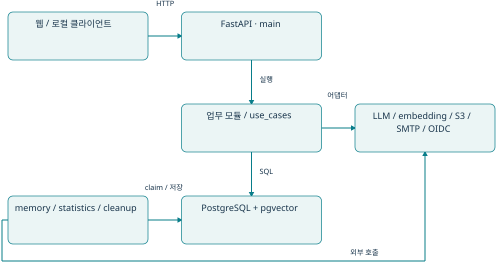

실선 화살표는 실행 호출 방향이다. main의 lifespan은 DB 엔진, 세션 팩토리, 인증, 저장소, LLM 어댑터, AnswerOrchestrator와 15초 답변 복구 루프를 조립한다. memory worker·통계 job·정리 CLI는 별도 프로세스로 실행해야 한다. provider 호출과 DB commit은 하나의 분산 트랜잭션으로 묶이지 않는다.

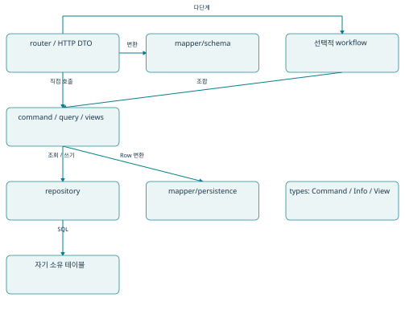

이 그림은 규칙의 대표 형태다. mapper는 repository를 호출하지 않으며 service가 원시 결과를 mapper로 전달한다. types는 값 계약이다. 조회도 Command를 입력으로 받는다. asset_storage처럼 DB가 없는 모듈에는 repository가 없고, reporting은 다른 공개 서비스의 결과를 조합한다. 단순 기능마다 workflow를 추가하지 않는다.

근거: apps/api/app/db/transaction.py:14 (use_case_transaction); apps/api/app/modules/content/character/service/command.py:44 (create_character); apps/api/app/modules/chatting/chat/service/workflow/answers.py:49 (AnswerOrchestrator)

정적 import 그래프의 간선은 호출 실행 횟수나 런타임 순서를 뜻하지 않는다. 공개 service/types만 쓰더라도 모듈 수준에서는 순환 의존이 남을 수 있다. 아래 표는 전체 모듈 간 import를 축약한 것이다. 개별 간선 근거는 module-dependencies.json에 있다.

| 가져오는 모듈 | 참조하는 다른 모듈 |
| --- | --- |
| asset_storage | 없음 |
| chatting/chat | chatting/conversation, chatting/memory, chatting/prompt, commerce/billing, content/product, identity, llm |
| chatting/conversation | content/lorebook, content/product, llm |
| chatting/memory | chatting/conversation, llm |
| chatting/prompt | chatting/conversation, chatting/memory |
| commerce/billing | commerce/credit, content/product, identity |
| commerce/credit | 없음 |
| content/character | asset_storage, content/tag, identity |
| content/lorebook | content/tag, identity |
| content/product | asset_storage, chatting/conversation, content/character, content/lorebook, content/tag, identity, llm |
| content/tag | identity |
| governance/admin | content/character, content/lorebook, content/product, content/tag, llm |
| governance/moderation | content/character, content/lorebook, content/product, identity |
| identity | 없음 |
| llm | content/product, identity |
| reporting/account_reporting | chatting/chat, commerce/billing, identity |
| reporting/creator_reporting | content/product, identity |
| reporting/operations_reporting | chatting/chat, content/product, identity |


상호 도달 가능한 모듈군: chatting/conversation ↔ content/product ↔ llm. 이는 정적 의존 그래프의 순환이다. 현재 import 실패나 런타임 무한 호출을 의미하지 않는다. product의 공개 View, conversation의 런타임 구성, llm의 대체 정책이 서로의 타입·공개 서비스를 참조하는 구조는 향후 변경 영향 검토 지점이다.

# 4. 모듈별 상세 소개

각 절의 diagram은 실제 파일에서 추출한 같은 모듈 내부 import를 계층별로 축약한다. 화살표는 “참조한다”이며 반환 데이터 흐름이 아니다. 공개 인터페이스는 주요 진입점 위주이고 전체 심볼은 inventory.json에 있다.

## asset_storage · 공급자 중립 파일 저장·읽기·삭제

책임과 계약: 호출자가 도메인 권한과 reader 수명을 소유한다. S3 boto3는 thread로 실행한다. 로컬 두 파일(본문·메타데이터)의 다중 프로세스 원자성까지 보장하지 않는다.

읽는 순서: types.py → service/settings.py → service/factory.py → service/storage.py → adapters/

주요 공개 진입점: AssetStorageService.store_asset / read_asset / delete_asset / aclose

소유 테이블: 없음.

참조 모듈: 없음. Python 파일 12개, 1,189줄(주석·공백 포함).

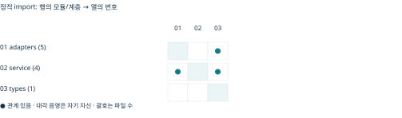

코드 근거: apps/api/app/modules/asset_storage/service/storage.py:19 (AssetStorageService). 모듈 의도: apps/api/app/modules/asset_storage/ARCHITECTURE.md:1

| 서비스 파일 | 주요 함수 / 책임 탐색 |
| --- | --- |
| service/factory.py | create_asset_storage_service |
| service/settings.py | load_asset_storage_settings |
| service/storage.py | AssetStorageService, store_asset, read_asset, delete_asset, get_asset_metadata, aclose |

## chatting/chat · 메시지·생성 실행권·최종 프롬프트

책임과 계약: 대화방 잠금·revision·request_key를 사용한다. 답변 요청키는 사용자 범위다. 결과·usage·기억 예약·크레딧 확정은 같은 최종 트랜잭션이다. stream.py는 빈 파일이며 답변 SSE 구현의 증거가 아니다.

읽는 순서: router/messages.py·answers.py → command/messages.py·generation.py → workflow/answers.py → repository.py

주요 공개 진입점: create_user_message / begin_generation / finish_generation; AnswerOrchestrator

소유 테이블: chat_message_requests, generation_prompts, messages, product_generations.

참조 모듈: chatting/conversation, chatting/memory, chatting/prompt, commerce/billing, content/product, identity, llm. Python 파일 31개, 3,547줄(주석·공백 포함).

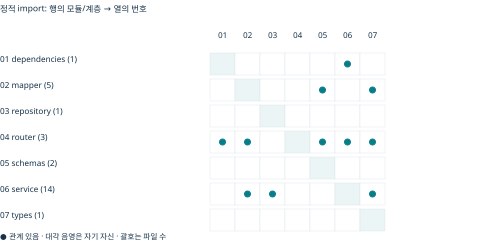

코드 근거: apps/api/app/modules/chatting/chat/service/workflow/answers.py:163 (generate_answer). 모듈 의도: apps/api/app/modules/chatting/chat/ARCHITECTURE.md:1

| 서비스 파일 | 주요 함수 / 책임 탐색 |
| --- | --- |
| service/command/answers.py | get_answer_request, get_answer_input, update_answer, list_expired_answers |
| service/command/generation.py | result_digest, begin_generation, finish_generation |
| service/command/messages.py | create_message, create_character_message, replace_message, replace_character_message, rewind_messages |
| service/command/prompts.py | save_generation_prompt |
| service/query/generation.py | get_generation_state, get_statistics_facts, get_account_generation_statistics |
| service/query/messages.py | list_messages, list_conversation_previews, list_conversation_activity, list_memory_source |
| service/query/prompts.py | list_generation_prompts, get_generation_prompt |
| service/workflow/answer_preparation.py | prepare_answer_context |
| service/workflow/answers.py | AnswerOrchestrator, finish_generation_and_schedule_memory, generate_answer, recover_answers |
| service/workflow/memory.py | process_memory_work |

## chatting/conversation · 대화방·참여자·현재/최초 버전

책임과 계약: 현재 product_snapshot_id와 최초 initial_snapshot_id는 다르다. 신규 고정 첫 대사는 messages에 저장하지 않고 시작 문맥으로 제공한다. 버전 변경이 이미 생성 중인 결과를 stale로 만들 수 있다.

읽는 순서: router.py → command/__init__.py·versions.py·context.py → views.py → repository.py

주요 공개 진입점: start_conversation / prepare_runtime_context / get_owned_conversation

소유 테이블: conversation_characters, conversation_version_changes, conversations.

참조 모듈: content/lorebook, content/product, llm. Python 파일 15개, 1,063줄(주석·공백 포함).

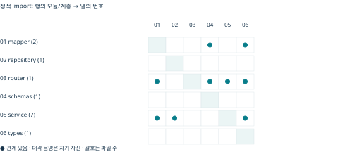

코드 근거: apps/api/app/modules/chatting/conversation/service/command/context.py:17 (prepare_runtime_context). 모듈 의도: apps/api/app/modules/chatting/conversation/ARCHITECTURE.md:1

| 서비스 파일 | 주요 함수 / 책임 탐색 |
| --- | --- |
| service/command/__init__.py | start_conversation |
| service/command/context.py | prepare_runtime_context |
| service/command/history.py | advance_history_revision |
| service/command/versions.py | switch_version |
| service/query.py | get_owned_conversation, list_owned_conversations, count_owned_conversations, get_statistics_facts, list_conversation_characters |
| service/views.py | list_manual_lore, get_conversation_start |

## chatting/memory · 요약·벡터 검색·durable 작업

책임과 계약: 메시지 원본은 chat이 제공한다. 1536차원 및 공급자·모델 일치로 벡터를 선택한다. 편집 시 history_revision을 올리고 요약을 무효화한다. lease 갱신 루프는 없다.

읽는 순서: command/scheduling.py·summarization.py·indexing.py → query/retrieval.py → repository.py

주요 공개 진입점: SummaryGenerator / MemoryIndexer / MemoryRetriever; claim_memory_work

소유 테이블: conversation_memories, memory_jobs.

참조 모듈: chatting/conversation, llm. Python 파일 14개, 1,623줄(주석·공백 포함).

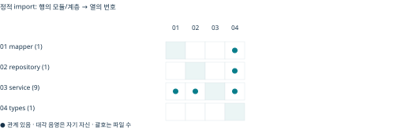

코드 근거: apps/api/app/modules/chatting/memory/service/command/scheduling.py:29 (claim_memory_work). 모듈 의도: apps/api/app/modules/chatting/memory/ARCHITECTURE.md:1

| 서비스 파일 | 주요 함수 / 책임 탐색 |
| --- | --- |
| service/command/indexing.py | content_digest, MemoryIndexer, save_summary_embedding, embed_summary |
| service/command/invalidation.py | invalidate_conversation_memories |
| service/command/scheduling.py | schedule_memory_work, claim_memory_work, complete_memory_work, fail_memory_work |
| service/command/summarization.py | estimate_tokens, plan_summarization, validate_summary_source, SummaryGenerator, save_summary, generate_summary |
| service/query/records.py | get_memory, list_memories, get_latest_summary, get_pending_index |
| service/query/retrieval.py | MemoryRetriever, search_memories, estimate_rendered_memory_tokens, retrieve_memories |

## chatting/prompt · 최종 공급자 중립 프롬프트 구성

책임과 계약: DB 없음. 서버 규칙은 system, 사용자가 작성한 참조는 user 데이터다. 현재 로어 placement에 따라 이력 앞·현재 입력 근처에 나눈다. 바이트 기반 보수적 예산은 실제 공급자 usage와 다르다.

읽는 순서: resources/default.json → service.py → types.py → llm/adapters/messages.py

주요 공개 진입점: load_template / build_prompt

소유 테이블: 없음.

참조 모듈: chatting/conversation, chatting/memory. Python 파일 4개, 179줄(주석·공백 포함).

코드 근거: apps/api/app/modules/chatting/prompt/service.py:59 (build_prompt). 모듈 의도: apps/api/app/modules/chatting/prompt/ARCHITECTURE.md:1

| 서비스 파일 | 주요 함수 / 책임 탐색 |
| --- | --- |
| service.py | validate_template, load_template, build_prompt |

## commerce/billing · 가격·견적·사용량·매출 귀속

책임과 계약: 고정 견적 예약액을 성공 시 확정한다. credit으로 지갑 쓰기를 위임한다. 현금 PG 승인·구독 실행은 구현되지 않았다. 정책 슬롯의 무효과 구현을 실제 할인 기능으로 읽으면 안 된다.

읽는 순서: service/pricing.py → quotes.py → credits.py → repository.py; 사용량은 command/

주요 공개 진입점: calculate_billing_price / create_billing_quote / reserve_credit / record_usage

소유 테이블: billing_credit_bindings, billing_quotes, payments, product_payment_events, subscription_plans, usage_logs, user_subscriptions.

참조 모듈: commerce/credit, content/product, identity. Python 파일 18개, 1,849줄(주석·공백 포함).

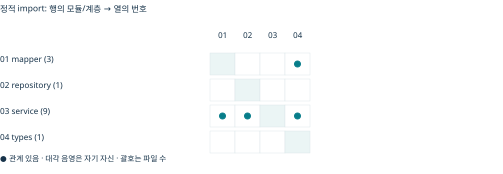

코드 근거: apps/api/app/modules/commerce/billing/service/credits.py:79 (reserve_credit). 모듈 의도: apps/api/app/modules/commerce/billing/ARCHITECTURE.md:1

| 서비스 파일 | 주요 함수 / 책임 탐색 |
| --- | --- |
| service/command/__init__.py | record_usage |
| service/command/attribution.py | record_sale, record_refund |
| service/configuration.py | load_billing_pricing_configuration |
| service/credits.py | get_credit_balance, reserve_credit, commit_credit_reservation, release_credit_reservation |
| service/policies.py | PricingPolicyAdapter, ProductAuthorPolicyAdapter, PromotionPolicyAdapter, UnpopularProductPolicyAdapter, PricingPolicyRegistration, PricingPolicyRegistry, create_default_policy_registry, policy, apply_policy, policy, apply_policy, policy, apply_policy, policy, apply_policy |
| service/pricing.py | BillingPricingConfiguration, calculate_billing_price |
| service/query.py | get_statistics_facts, get_account_usage_statistics |
| service/quotes.py | create_billing_quote, get_billing_quote, validate_billing_quote |

## commerce/credit · 재화별 지갑·무료/유료 배분·원장

책임과 계약: 명시적인 상위 transaction이 필요하다. 무료분을 우선 예약하고 최초 배분을 확정/해제에 재사용한다. legacy 미분류 데이터는 자동 활성화하지 않는다.

읽는 순서: types.py → service/command.py·query.py → repository.py → mapper/persistence.py

주요 공개 진입점: prepare_credit_wallet / grant_credit / reserve_credit / commit_credit_reservation

소유 테이블: credit_accounts, credit_balances, credit_reservations, credit_transaction_entries, credit_transactions, credit_wallets.

참조 모듈: 없음. Python 파일 8개, 1,203줄(주석·공백 포함).

코드 근거: apps/api/app/modules/commerce/credit/service/command.py:64 (reserve_credit). 모듈 의도: apps/api/app/modules/commerce/credit/ARCHITECTURE.md:1

| 서비스 파일 | 주요 함수 / 책임 탐색 |
| --- | --- |
| service/command.py | lock_credit_account, reserve_credit, commit_credit_reservation, release_credit_reservation, prepare_credit_wallet, grant_credit |
| service/query.py | get_credit_balance, get_credit_reservation, list_credit_transactions, list_credit_reservations |

## content/character · 캐릭터 원본·발행 스냅샷·미디어 참조

책임과 계약: 업로드 예약→공급자 작업→ready, 정리는 deleting→삭제→deleted다. 스냅샷 FK가 남아 있으면 원본을 삭제해도 객체 정리는 막는다.

읽는 순서: router.py → service/command.py·query.py → repository.py → mapper/; 업로드는 workflow/media.py

주요 공개 진입점: create_character / update_character / freeze_character; CharacterMediaWorkflow

소유 테이블: character_assets, character_images, character_internal_tags, character_media, character_snapshot_assets, character_snapshot_images, character_snapshots, character_tags, characters.

참조 모듈: asset_storage, content/tag, identity. Python 파일 18개, 3,051줄(주석·공백 포함).

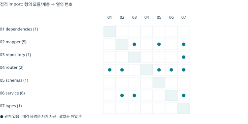

코드 근거: apps/api/app/modules/content/character/service/workflow/media.py:34 (upload_character_media). 모듈 의도: apps/api/app/modules/content/character/ARCHITECTURE.md:1

| 서비스 파일 | 주요 함수 / 책임 탐색 |
| --- | --- |
| service/command.py | create_character, update_character, change_character_status, delete_character, add_character_image, delete_character_image, add_character_asset, delete_character_asset, set_default_character_image, freeze_character |
| service/media.py | CharacterMediaService, reserve_upload, lock_upload, complete_upload, read_character_media, read_snapshot_media, prepare_cleanup, lock_cleanup, complete_cleanup |
| service/query.py | list_characters, list_characters_by_owner_id, get_character_by_id, get_character_by_id_and_owner_id, get_character_image, get_character_image_by_emotion_tag, get_default_character_image, list_character_images, get_character_asset, list_character_assets, get_character_prompt, get_character_promotion, get_owned_characters, get_snapshot_media, check_media_reference, get_character_snapshots |
| service/tags.py | list_public_tags, add_public_tags, replace_public_tags, remove_public_tag, list_internal_tags, add_internal_tags, replace_internal_tags, set_system_tags, remove_internal_tag, remove_system_tag, list_system_tags |
| service/workflow/media.py | CharacterMediaWorkflow, upload_character_media, cleanup_character_media |

## content/lorebook · 로어 항목·스냅샷·활성화 규칙

책임과 계약: 현재 activation.py는 v1 옵션의 깊이·화자·대소문자·배타 그룹·항목 예산·manual 선택을 지원한다. semantic은 미지원이다. 기존 문서의 manual/예산 미지원 설명과 구분해야 한다.

읽는 순서: router.py → service/command.py·query.py → service/activation.py → repository.py

주요 공개 진입점: create_lorebook_entry / freeze_lorebook / activate_snapshot_entries

소유 테이블: lorebook_entries, lorebook_internal_tags, lorebook_snapshots, lorebook_tags, lorebooks.

참조 모듈: content/tag, identity. Python 파일 20개, 2,545줄(주석·공백 포함).

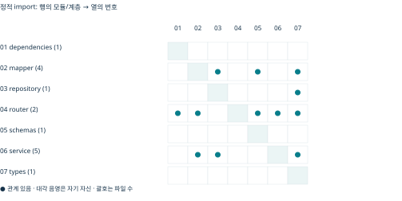

코드 근거: apps/api/app/modules/content/lorebook/service/activation.py:54 (diagnose_entries). 모듈 의도: apps/api/app/modules/content/lorebook/ARCHITECTURE.md:1

| 서비스 파일 | 주요 함수 / 책임 탐색 |
| --- | --- |
| service/activation.py | validate_options, diagnose_entries |
| service/command.py | create_lorebook, update_lorebook, change_lorebook_status, delete_lorebook, create_lorebook_entry, update_lorebook_entry, delete_lorebook_entry, freeze_lorebook |
| service/query.py | diagnose_draft_entries, list_lorebooks, list_lorebooks_by_owner_id, get_lorebook_by_id, get_lorebook_by_id_and_owner_id, list_lorebook_entries, list_lorebook_entries_by_owner_id, get_lorebook_entry, get_lorebook_entry_by_owner_id, activate_snapshot_entries, get_always_entries, activate_keyword_entries, list_start_sets, get_owned_lorebooks, get_start_entries, get_lorebook_snapshots |
| service/tags.py | list_public_tags, add_public_tags, replace_public_tags, remove_public_tag, list_internal_tags, add_internal_tags, replace_internal_tags, set_system_tags, remove_internal_tag, remove_system_tag, list_system_tags |
| service/util/matching.py | InvalidLorebookRegex, validate_regex, regex_matches |

## content/product · 작품 구성·발행·정책·일별 통계

책임과 계약: 원본과 발행본을 분리한다. product_generations와 product_payment_events는 이름과 달리 이 모듈 소유가 아니다. studio 후속 발행은 use_cases가 조합한다.

읽는 순서: router.py → command/composition.py·settings.py → releases.py·publication.py → views/ → repository/

주요 공개 진입점: create_product / publish_product / get_accessible_product / get_snapshot_runtime

소유 테이블: product_characters, product_daily_stats, product_internal_tags, product_lorebook_characters, product_lorebooks, product_release_note_revisions, product_release_notes, product_snapshot_characters, product_snapshot_lorebook_characters, product_snapshot_lorebooks, product_snapshot_policy_changes, product_snapshot_start_sets, product_snapshots, product_start_sets, product_stats_dirty_days, product_studio_drafts, product_tags, product_user_daily_activity, product_version_daily_stats, product_version_user_daily_activity, products.

참조 모듈: asset_storage, chatting/conversation, content/character, content/lorebook, content/tag, identity, llm. Python 파일 43개, 4,553줄(주석·공백 포함).

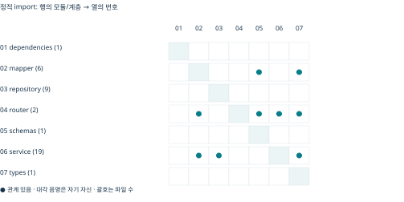

코드 근거: apps/api/app/modules/content/product/service/command/publication.py:25 (_build_publication). 모듈 의도: apps/api/app/modules/content/product/ARCHITECTURE.md:1

| 서비스 파일 | 주요 함수 / 책임 탐색 |
| --- | --- |
| service/command/__init__.py | validate_profile, create_product, update_product, delete_product, change_snapshot_expiry, change_product_status |
| service/command/composition.py | replace_composition |
| service/command/publication.py | 내부 보조 / 재노출 |
| service/command/releases.py | validate_note, publish_product, correct_note |
| service/command/settings.py | set_settings |
| service/command/statistics.py | replace_statistics_day, claim_statistics_work, complete_statistics_work, enqueue_recent |
| service/command/statistics_queue.py | mark_statistics_dirty |
| service/command/studio.py | save_studio_draft, mark_studio_publication, set_studio_components |
| service/query/__init__.py | get_owned_product, get_product_snapshot, get_product, list_products, list_catalog, count_products, list_catalog_tags, ensure_snapshot_available, get_accessible_product, list_product_releases, get_snapshot_composition, get_product_state, ensure_available |
| service/query/composition.py | get_composition |
| service/query/reporting.py | get_owner_reporting_statistics, get_admin_reporting_statistics, get_recorded_service_statistics, get_statistics_queue |
| service/query/statistics.py | get_statistics |
| service/query/studio.py | get_studio_draft, get_studio_draft_for_publication |
| service/tags.py | list_public_tags, add_public_tags, replace_public_tags, remove_public_tag, list_internal_tags, add_internal_tags, replace_internal_tags, set_system_tags, remove_internal_tag, remove_system_tag, list_system_tags |
| service/views/__init__.py | get_snapshot_runtime |
| service/views/media.py | ProductMediaService, read_product_media |
| service/views/notices.py | get_published_product, get_pending_updates, get_version_availability |
| service/views/snapshots.py | check_media_reference |

## content/tag · 공통 태그 사전

책임과 계약: 이름의 앞뒤 공백만 정규화하며 대소문자·동의어를 통합하지 않는다. 콘텐츠별 연결 6개는 각 콘텐츠 모듈 소유다. 사전 비활성화는 기존 연결을 보존한다.

읽는 순서: service/command.py → service/query.py → repository.py → mapper/persistence.py

주요 공개 진입점: resolve_tags / create_tag / update_tag / deactivate_tag

소유 테이블: tags.

참조 모듈: identity. Python 파일 5개, 286줄(주석·공백 포함).

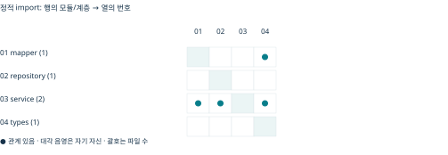

코드 근거: apps/api/app/modules/content/tag/service/command.py:18 (resolve_tags). 모듈 의도: apps/api/app/modules/content/tag/ARCHITECTURE.md:1

| 서비스 파일 | 주요 함수 / 책임 탐색 |
| --- | --- |
| service/command.py | resolve_tags, create_tag, update_tag, deactivate_tag |
| service/query.py | get_admin_tag, get_tag, get_tag_by_name, get_tags |

## governance/admin · 관리자 HTTP 및 도메인 조율

책임과 계약: 자체 테이블이 없다. 태그·상품·모델 경로는 서비스에서 역할을 재확인한다. 기존 캐릭터·로어 전역 조회는 미연결 전용 guard에 의존한다.

읽는 순서: product_router.py·model_router.py·tag_router.py → service/command.py → 대상 공개 service

주요 공개 진입점: 상품 상태·만료, 모델 종료, 태그 관리 경로

소유 테이블: 없음.

참조 모듈: content/character, content/lorebook, content/product, content/tag, llm. Python 파일 16개, 842줄(주석·공백 포함).

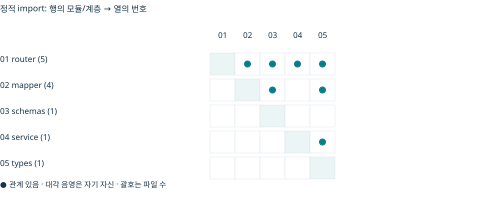

코드 근거: apps/api/app/modules/governance/admin/character_router.py:3 (router). 모듈 의도: apps/api/app/modules/governance/admin/ARCHITECTURE.md:1

| 서비스 파일 | 주요 함수 / 책임 탐색 |
| --- | --- |
| service/command.py | set_expiry, moderate_product |

## governance/moderation · 신고·평가·조치 요청·기존 검수 HTTP

책임과 계약: 신고 접수와 위반 확정, 조치 요청과 실제 제재 적용을 분리한다. 신규 내부 서비스 HTTP와 실제 적용자는 없다. applied 상태를 만드는 공개 실행 구현은 확인되지 않았다.

읽는 순서: service/command/reports.py → assessments.py → actions.py → repository/review.py

주요 공개 진입점: submit_report / record_manual_assessment / request_action / cancel_pending_action

소유 테이블: audit_logs, moderation_actions, moderation_assessment_reports, moderation_assessments, moderation_flags, moderation_reports.

참조 모듈: content/character, content/lorebook, content/product, identity. Python 파일 22개, 1,679줄(주석·공백 포함).

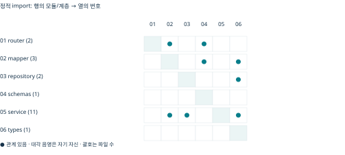

코드 근거: apps/api/app/modules/governance/moderation/service/command/actions.py:44 (request_action). 모듈 의도: apps/api/app/modules/governance/moderation/ARCHITECTURE.md:1

| 서비스 파일 | 주요 함수 / 책임 탐색 |
| --- | --- |
| service/command/actions.py | request_action, cancel_pending_action |
| service/command/assessments.py | record_manual_assessment, record_automatic_assessment |
| service/command/reports.py | submit_report, change_report_intake |
| service/query/actions.py | get_action, list_actions, list_retry_actions |
| service/query/assessments.py | get_assessment, list_assessments |
| service/query/reports.py | get_own_report, list_own_reports, get_admin_report, list_admin_reports |
| service/util/validation.py | validate_text, validate_time, validate_target, validate_page, request_fingerprint, require_match, require_info, legacy_review_status, action_request_info |

## identity · 인증·세션·증명·요청 제한

책임과 계약: JWT 서명만 확인하지 않고 현재 사용자·세션 상태를 조회한다. refresh 재사용 폐기는 commit 이후 오류를 낸다. SMTP 전송은 증명 commit 이후다.

읽는 순서: router.py → service/authentication.py → repository.py → security.py; 외부 통신은 service/workflow/mail.py·google.py

주요 공개 진입점: AuthenticationService; AuthenticationMailWorkflow; GoogleLoginService; require_active_user / require_admin

소유 테이블: auth_action_tokens, auth_oauth_attempts, auth_rate_limits, auth_sessions, user_oauth_accounts, users.

참조 모듈: 없음. Python 파일 20개, 1,921줄(주석·공백 포함).


코드 근거: apps/api/app/modules/identity/service/authentication.py:279 (refresh_session). 모듈 의도: apps/api/app/modules/identity/ARCHITECTURE.md:1

| 서비스 파일 | 주요 함수 / 책임 탐색 |
| --- | --- |
| service/authentication.py | AuthenticationService, check_rate_limit, register_pending_user, prepare_action_mail, verify_email, reset_password, issue_session, login_user, get_authenticated_user, refresh_session, logout_session, logout_all_sessions, cleanup_expired_auth |
| service/google.py | create_google_state, consume_google_state, link_google_account |
| service/query.py | require_admin, require_active_user, get_reportable_user |
| service/workflow/google.py | GoogleLoginService, start_google_login, complete_google_login |
| service/workflow/mail.py | AuthenticationMailWorkflow, register_user, resend_verification, request_password_reset |

## llm · 텍스트 생성·임베딩·모델 카탈로그·대체 정책

책임과 계약: 텍스트와 임베딩 등록소를 분리한다. request_json을 공급자별 메시지로 변환한다. DB 모델 활성 정책과 SDK의 지원 모델 판단은 별개다.

읽는 순서: service/text_generation.py·embedding.py → adapters/protocols.py → 개별 adapter; DB 모델 선택은 service/command/replacement.py

주요 공개 진입점: TextGenerationService.generate_text; EmbeddingService.embed_texts; resolve_execution

소유 테이블: model_replacements, models, providers.

참조 모듈: content/product, identity. Python 파일 24개, 1,804줄(주석·공백 포함).

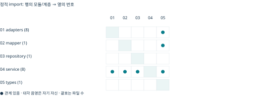

코드 근거: apps/api/app/modules/llm/service/text_generation.py:18 (TextGenerationService). 모듈 의도: apps/api/app/modules/llm/ARCHITECTURE.md:1

| 서비스 파일 | 주요 함수 / 책임 탐색 |
| --- | --- |
| service/command/replacement.py | announce_retirement, resolve_execution |
| service/embedding.py | EmbeddingService, embed_texts, aclose |
| service/query.py | get_model, get_provider, list_candidate_models, validate_model |
| service/text_generation.py | TextGenerationService, list_model_options, generate_text, aclose |
| service/util/replacement_policy.py | closest_effort, choose_replacement |
| service/views/replacement.py | execution_notice |

## reporting/account_reporting · 본인 생성·기록 사용량 조합

책임과 계약: 소유 테이블 없음. 생성 created_at과 usage created_at이 다른 코호트라 두 건수의 일치를 보장하지 않는다. 공급자 전체 비용이나 원장 잔액을 뜻하지 않는다.

읽는 순서: service/views.py → chat·billing 공개 query → mapper/persistence.py

주요 공개 진입점: get_account_report

소유 테이블: 없음.

참조 모듈: chatting/chat, commerce/billing, identity. Python 파일 6개, 139줄(주석·공백 포함).

코드 근거: apps/api/app/modules/reporting/account_reporting/service/views.py:21 (get_account_report). 모듈 의도: apps/api/app/modules/reporting/account_reporting/ARCHITECTURE.md:1

| 서비스 파일 | 주요 함수 / 책임 탐색 |
| --- | --- |
| service/views.py | get_account_report |

## reporting/creator_reporting · 소유 작품의 집계 조회

책임과 계약: 소유자 범위를 재검증한다. missing은 0이 아니며 dirty/누락이 있을 때 확정 totals를 제공하지 않는다. 작가에게 원문·개별 사용자·매출은 노출하지 않는다.

읽는 순서: service/views.py → product 공개 reporting → mapper/persistence.py

주요 공개 진입점: get_product_report

소유 테이블: 없음.

참조 모듈: content/product, identity. Python 파일 6개, 177줄(주석·공백 포함).

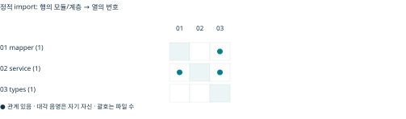

코드 근거: apps/api/app/modules/reporting/creator_reporting/service/views.py:19 (get_product_report). 모듈 의도: apps/api/app/modules/reporting/creator_reporting/ARCHITECTURE.md:1

| 서비스 파일 | 주요 함수 / 책임 탐색 |
| --- | --- |
| service/views.py | get_product_report |

## reporting/operations_reporting · 관리자 집계·최종 프롬프트 조회

책임과 계약: 일반 집계는 내부 서비스다. 프롬프트 목록/상세만 HTTP에 노출한다. 목록은 원문 제외, 상세는 활성 admin 재검증 및 no-store다. 저장은 실제 전송 성공의 증거가 아니다.

읽는 순서: router.py → service/prompts.py·views.py → chat·product 공개 query

주요 공개 진입점: get_recorded_service_report / get_statistics_queue_report / get_generation_prompt

소유 테이블: 없음.

참조 모듈: chatting/chat, content/product, identity. Python 파일 11개, 594줄(주석·공백 포함).

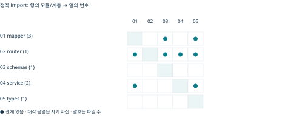

코드 근거: apps/api/app/modules/reporting/operations_reporting/service/prompts.py:39 (get_generation_prompt). 모듈 의도: apps/api/app/modules/reporting/operations_reporting/ARCHITECTURE.md:1

| 서비스 파일 | 주요 함수 / 책임 탐색 |
| --- | --- |
| service/prompts.py | list_generation_prompts, get_generation_prompt |
| service/views.py | get_product_report, get_recorded_service_report, get_statistics_queue_report |

## 모듈 밖의 조립 계층

http는 전체 라우트와 공유 HTTP 계약·의존성을 소유한다. use_cases는 product_statistics, conversation_directory, account_overview와 studio_content/components/diagnostics/publication을 조합한다. studio_publication은 현재 후속 발행 receipt를 revision별로 보존하며, 원본 컴포넌트 ID를 재사용하고 이전 스냅샷을 수정하지 않는다. use_cases/ARCHITECTURE.md의 세 파일만 존재한다는 설명은 최신 구현을 포괄하지 못한다.

근거: apps/api/app/http/routes.py:1; apps/api/app/use_cases/studio_publication.py:103 (publish_studio); apps/api/app/use_cases/studio_components.py:18 (component_mapping); apps/api/app/use_cases/product_statistics.py:20 (rebuild_day)

# 5. 전반적인 코드 패턴

| 패턴 | 현재 구현 / 평가 |
| --- | --- |
| 입력 | Pydantic RequestDto → Command. product/chat은 extra=forbid, 일부 character DTO는 기본 extra 무시. 사용자 owner_id를 신뢰하지 않고 dependency의 ID를 mapper가 주입. |
| 업무 판단 | service는 mapper가 만든 Info로 존재·소유권·상태를 판단. repository는 SQL/flush. router가 SQL을 실행하지 않는지 기존 AST 테스트로 검사. |
| 응답 | Info/View → ResponseDto. product는 from_attributes model_validate. 이 경계의 nullable 불일치는 성공 조회 뒤 응답 오류가 될 수 있음(F01). |
| 트랜잭션 | 일반 command는 use_case_transaction. 중첩 실패는 rollback-only. credit/billing 예약은 명시 상위 transaction+SAVEPOINT. |
| 의존성 주입 | main이 sessions·storage·LLM·인증 객체를 구성하고 FastAPI hook을 override. 모듈 단독 router 기본값은 503. |
| 예외 | identity는 error.code, 일반 content는 detail, chat은 도메인별 HTTP 변환. 의도된 계약 차이이며 일괄 변경 시 클라이언트 호환성 주의. |
| 비동기 | SQLAlchemy async·공급자 async; boto3는 to_thread. 미디어 취소는 실제 저장 작업 종료를 기다린 뒤 DB lock 해제. |
| 설정 | auth/storage는 시작 시 검증. 가격표 미설정은 기존 조회·복구를 허용하되 신규 답변을 거절. |
| 관측 | structlog의 정규화 error_kind 및 식별자. 기본 API 엔진 hide_parameters=True. auth 접근 로그는 query string 제거. |

실제 예: character.create_character는 use_case_transaction 안에서 프로필을 검증하고 repository 결과를 persistence mapper에 전달한다. 태그가 있으면 같은 transaction에서 태그 공개 서비스로 연결한다. 이 구조를 새 코드의 기준 예제로 삼을 수 있다.

근거: apps/api/app/modules/content/character/service/command.py:44 (create_character); apps/api/app/modules/content/product/mapper/schema.py:120 (published_view_to_response); apps/api/app/http/dependencies.py:31 (errors); apps/api/app/modules/identity/http_security.py:134 (AuthRoute)

현재 구현의 예외: use_cases/account_overview는 dict[str,int]를 반환하고 http/account_credits가 즉석 DTO를 정의한다. 외부 서비스·폴더 구조만을 이유로 전면 리팩터링할 필요는 없지만 공개 응답 계약의 명시성과 테스트 범위를 맞추는 편이 좋다. 기본 패턴 차이가 곧 버그는 아니다.

유지보수 제안: 구조 규칙을 기계적으로 적용하기 전에 유스케이스 경계, 호출자의 신뢰 수준, 예외를 누가 HTTP로 바꾸는지부터 확인한다. Ruff의 광범위 예외 지적도 답변의 모호한 commit 복구 의도와 함께 판단해야 한다.

## 짧은 실제 코드 발췌

다음은 실제 파일에서 가져온 한 줄씩의 발췌다. 독립 실행 예제가 아니며 주변 검증·예외·트랜잭션 코드는 생략했다. 구현을 수정할 때에는 표시한 심볼 전체를 읽는다.

| 패턴 / 실제 코드 발췌 | 역할과 근거 |
| --- | --- |
| 입력 계약 — model_config = ConfigDict(extra="forbid") | 알 수 없는 입력 필드를 거절한다. 모든 DTO가 같은 정책인 것은 아니다. 근거: apps/api/app/http/contracts/tags.py:10 (model_config = ConfigDict(extra="forbid")) |
| 업무 트랜잭션 — async with use_case_transaction(session): | 업무 단위의 commit/rollback을 공통 컨텍스트에 맡긴다. 근거: apps/api/app/modules/content/character/service/command.py:47 (async with use_case_transaction(session):) |
| 저장소 접근 — row = await Repository.create_character_command(session, command) | service가 repository의 SQL 실행 결과를 받아 mapper로 넘긴다. 근거: apps/api/app/modules/content/character/service/command.py:50 (row = await Repository.create_character_command(session, command)) |
| 응답 변환 — return Schemas.PublishedProductInfoResponseDto.model_validate(result) | 반환 계약을 다시 검증한다. nullable 불일치가 이 단계에서 드러날 수 있다. 근거: apps/api/app/modules/content/product/mapper/schema.py:123 (return Schemas.PublishedProductInfoResponseDto.model_validate(result)) |
| 인증 객체 주입 — Owner = Annotated[UUID, Depends(get_current_owner_id)] | 검증된 호출자 ID의 주입 지점이다. 데이터 소유권 검사는 service의 별도 책임이다. 근거: apps/api/app/http/dependencies.py:27 (Owner = Annotated[UUID, Depends(get_current_owner_id)]) |
| 오류 응답 — raise HTTPException(422, str(exc)) from exc | ValueError를 업무 입력 오류로 변환한다. DB 제약 예외는 이 분기에 자동 포함되지 않는다. 근거: apps/api/app/http/dependencies.py:37 (raise HTTPException(422, str(exc)) from exc) |
| 취소 처리 — await asyncio.shield(task) | 저장 작업의 종료를 기다리기 위해 취소 전파를 제어한다. 실패·종료 경로까지 함께 읽어야 한다. 근거: apps/api/app/modules/content/character/service/workflow/media.py:19 (await asyncio.shield(task)) |
| DB 로그 설정 — os.environ["DATABASE_URL"], pool_pre_ping=True, hide_parameters=True | 엔진 연결 검사와 SQL 바인딩 값 은닉을 설정한다. URL 값 자체는 보고서에 수록하지 않는다. 근거: apps/api/app/main.py:72 (os.environ["DATABASE_URL"], pool_pre_ping=True, hide_parameters=True) |

# 6. 핵심 요청 흐름

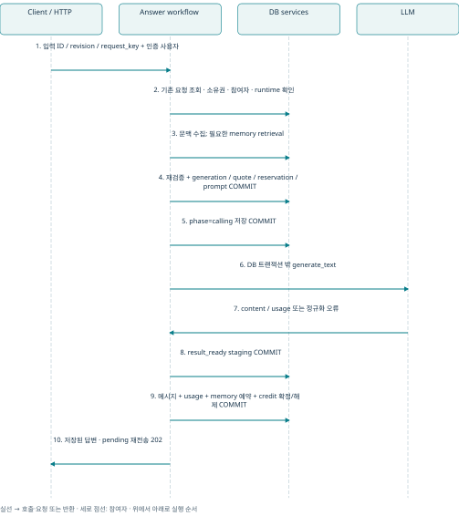

준비 후 DB 잠금을 재획득해 준비 digest와 실행 조건을 비교한다. 최종 프롬프트는 어댑터 변환 전 request_json 그대로 저장한다. 실패·취소·stale는 청구 0이며 예약을 해제한다. 불확실한 외부 호출은 같은 키로 조회·복구하되 다시 실행하지 않는다. result_ready가 있으면 저장 결과를 재사용하고, calling 단계에서 결과가 없으면 불확실 실패를 기록한다. 이 계약은 exactly-once 외부 호출을 보장한다는 뜻이 아니다.

근거: apps/api/app/modules/chatting/chat/service/workflow/answers.py:163 (generate_answer); apps/api/app/modules/chatting/chat/service/workflow/answers.py:530 (_finalize); apps/api/app/modules/chatting/chat/service/command/prompts.py:15 (save_generation_prompt)

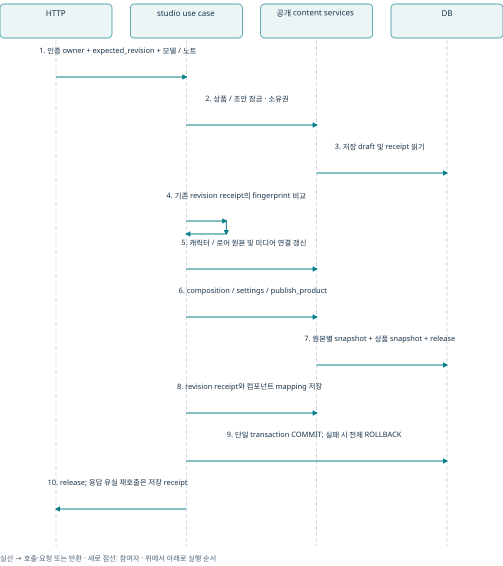

상품 → 소스 캐릭터 → 로어북의 잠금과 같은 DB 세션을 공유한다. 업로드된 파일은 이미 ready여야 하며 발행 과정에서 파일을 새로 업로드하지 않는다. raw publish_product는 요청키 멱등 API가 아니고, studio use case의 revision receipt가 재전송 계약을 추가한다. 현재 후속 발행을 지원하는 코드와 기존 문서·테스트의 “첫 발행 후 수정 거절” 설명이 다르다(F05/F06).

근거: apps/api/app/use_cases/studio_publication.py:103 (publish_studio); apps/api/app/modules/content/product/service/command/studio.py:13 (save_studio_draft); apps/api/app/modules/content/product/service/command/releases.py:36 (publish_product)

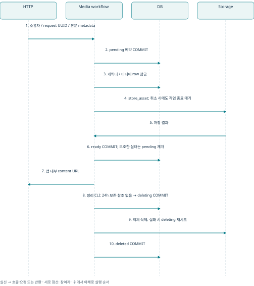

답변 생성과 달리 미디어는 저장소 작업이 실제로 끝날 때까지 DB 잠금을 유지하는 의도된 예외다. S3 thread 작업을 취소했다고 서버 측 쓰기가 즉시 종료되는 것은 아니기 때문이다. HTTP reader는 StreamingResponse 종료 시 닫는다. 이 파일 스트리밍과 답변 토큰 스트리밍을 구분해야 한다.

근거: apps/api/app/modules/content/character/service/workflow/media.py:12 (_settle_storage); apps/api/app/http/media.py:1; apps/api/app/media_cleanup.py:1

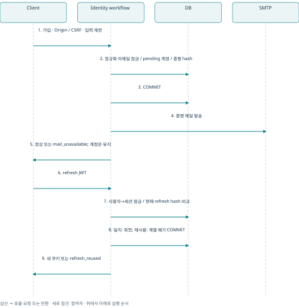

refresh 응답 유실 뒤 예전 토큰을 재전송하면 계열 폐기가 발생할 수 있다. 이 정책은 문서화된 계약이다. 클라이언트 탭 간 갱신 직렬화가 필요하다. Google 로그인은 state를 외부 통신 전에 소모하고, 실패 시 새 로그인 흐름으로 다시 시작한다.

근거: apps/api/app/modules/identity/service/authentication.py:279 (refresh_session); apps/api/app/modules/identity/service/workflow/mail.py:1; apps/api/app/modules/identity/service/workflow/google.py:1

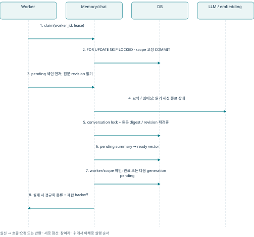

동시에 메시지가 편집되면 저장 직전에 source ID·position·revision·digest를 다시 확인한다. append만으로 이전 범위의 요약이 무효화되지는 않는다. lease 기간보다 작업이 오래 걸릴 때 외부 호출 중복 가능성은 별도로 관리해야 한다(F07).

근거: apps/api/app/modules/chatting/chat/service/workflow/memory.py:172 (_persist_summary); apps/api/app/modules/chatting/memory/repository.py:355 (claim_memory_work)

# 7. DB 구조와 관계도

ERD는 현재 SQLAlchemy 메타데이터로 생성했다. 운영 DB introspection이 아니다. PostgreSQL migration이 적용된 실환경과 일치한다고 단정하지 않는다. 전체 ERD는 도메인 개요와 모든 FK의 도메인별 분할 그림으로 구성하고, 테이블 사전에 600개 컬럼 및 제약을 수록했다. 독립 테이블도 사전에서 누락하지 않았다.


화살표는 자식의 FK → 참조 부모 방향이다. 숫자는 도메인 소유 테이블 수다. 이 그림의 도메인 간 선은 물리 FK가 존재함을 뜻하며 서비스 import나 호출 권한을 뜻하지 않는다. 세부 그림은 FK 하나를 한 행으로 펼쳐 교차선을 줄였다.

| 소유 도메인 | 주요 생성·수정·삭제 주체 |
| --- | --- |
| identity | 가입/로그인/증명/refresh; auth_cleanup 만료 정리 |
| character / lorebook | owner command; product 발행이 공개 freeze 호출; media cleanup은 참조 없는 객체만 삭제 |
| product | 편집·발행 command; statistics use case가 집계/dirty queue 갱신 |
| conversation / chat | 시작·버전 command; 메시지 편집·rewind; 답변 workflow; 관리자 prompt 조회는 읽기 |
| memory | worker 저장·색인; chat 편집 시 공개 무효화 서비스; conversation FK CASCADE |
| billing / credit | 견적·usage·결제 귀속; 서버 전용 지급/예약/정산. 현금 승인 실행자는 없음 |
| moderation | report/assessment/action command; actual 제재 적용자는 미구현 |
| tag / llm | 관리자 사전·종료 정책; content가 연결 소유; 원본 상태와 발행 snapshot 분리 |

범례: 부모/자식의 수량은 FK nullable 및 자식 FK 컬럼의 PK/UNIQUE로 추론했다. “자식당 부모 1”은 필수 FK, “0..1”은 nullable FK다. “부모당 자식 0..1”은 유일 FK, “0..N”은 반복 가능 FK다. 부분 UNIQUE와 복합 MATCH SIMPLE의 NULL 조합은 도표보다 세부 제약을 우선한다. DELETE/UPDATE가 NO ACTION이면 자동 연쇄 변경을 지정하지 않은 것이다.

## governance/moderation 관계

소유 테이블: audit_logs, moderation_actions, moderation_assessment_reports, moderation_assessments, moderation_flags, moderation_reports.

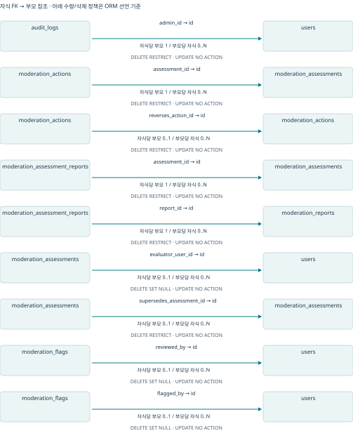

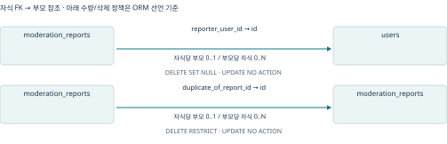

## identity 관계

소유 테이블: auth_action_tokens, auth_oauth_attempts, auth_rate_limits, auth_sessions, user_oauth_accounts, users.

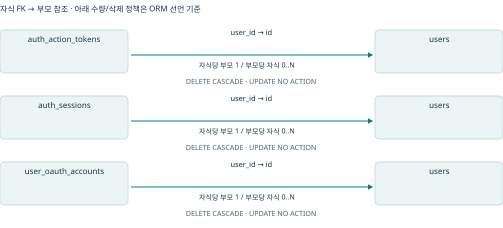

## commerce/billing 관계

소유 테이블: billing_credit_bindings, billing_quotes, payments, product_payment_events, subscription_plans, usage_logs, user_subscriptions.

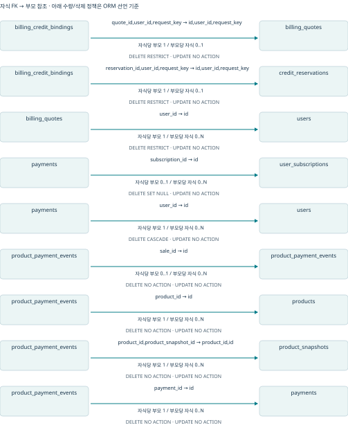

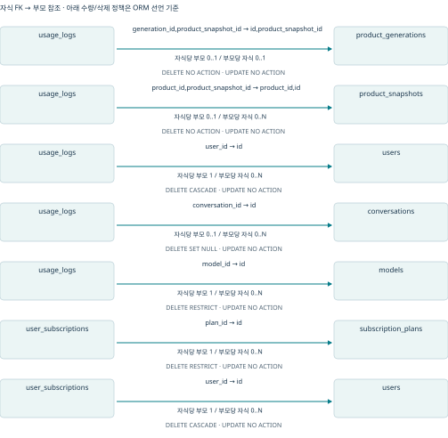

## content/character 관계

소유 테이블: character_assets, character_images, character_internal_tags, character_media, character_snapshot_assets, character_snapshot_images, character_snapshots, character_tags, characters.

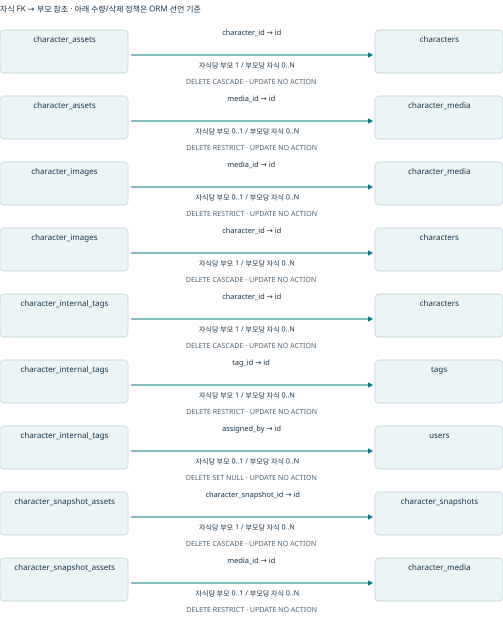

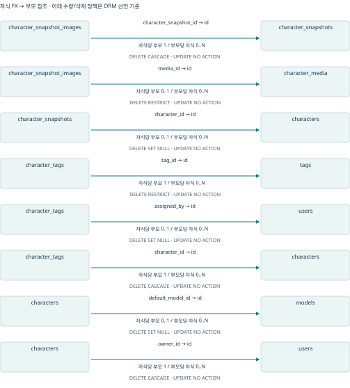

## chatting/chat 관계

소유 테이블: chat_message_requests, generation_prompts, messages, product_generations.

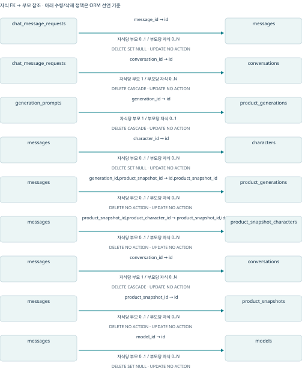

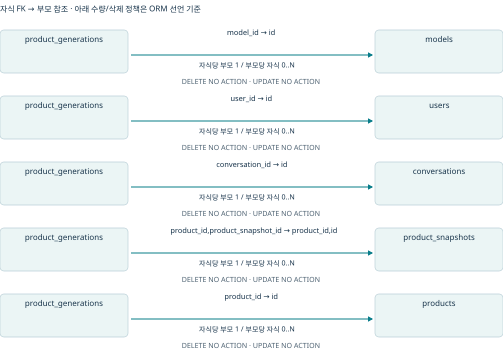

## chatting/conversation 관계

소유 테이블: conversation_characters, conversation_version_changes, conversations.

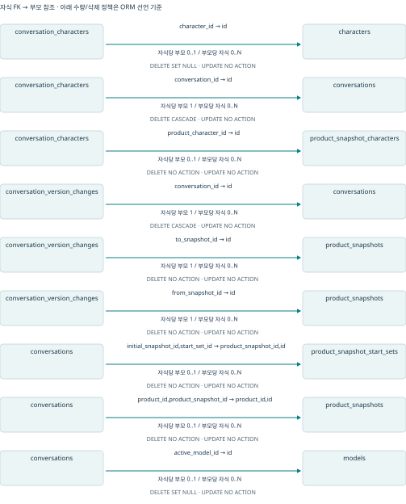

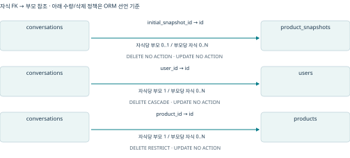

## chatting/memory 관계

소유 테이블: conversation_memories, memory_jobs.

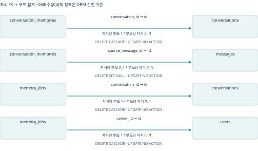

## commerce/credit 관계

소유 테이블: credit_accounts, credit_balances, credit_reservations, credit_transaction_entries, credit_transactions, credit_wallets.

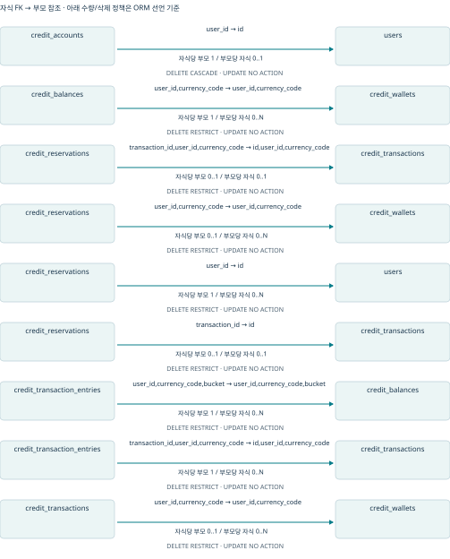

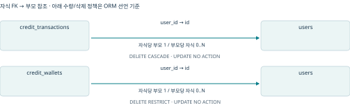

## content/lorebook 관계

소유 테이블: lorebook_entries, lorebook_internal_tags, lorebook_snapshots, lorebook_tags, lorebooks.

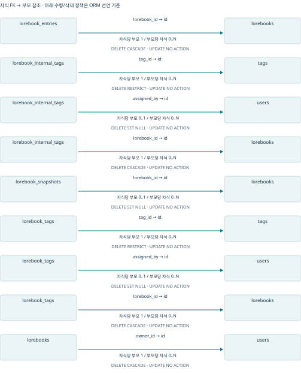

## llm 관계

소유 테이블: model_replacements, models, providers.

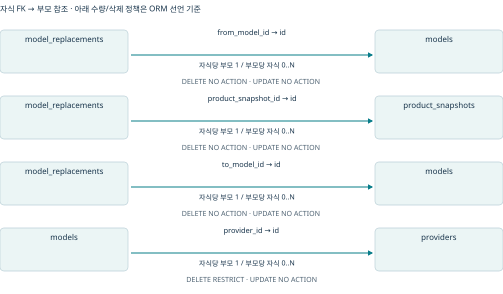

## content/product 관계

소유 테이블: product_characters, product_daily_stats, product_internal_tags, product_lorebook_characters, product_lorebooks, product_release_note_revisions, product_release_notes, product_snapshot_characters, product_snapshot_lorebook_characters, product_snapshot_lorebooks, product_snapshot_policy_changes, product_snapshot_start_sets, product_snapshots, product_start_sets, product_stats_dirty_days, product_studio_drafts, product_tags, product_user_daily_activity, product_version_daily_stats, product_version_user_daily_activity, products.

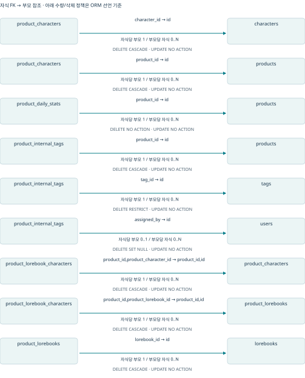

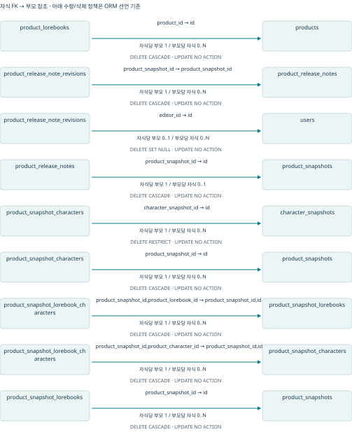

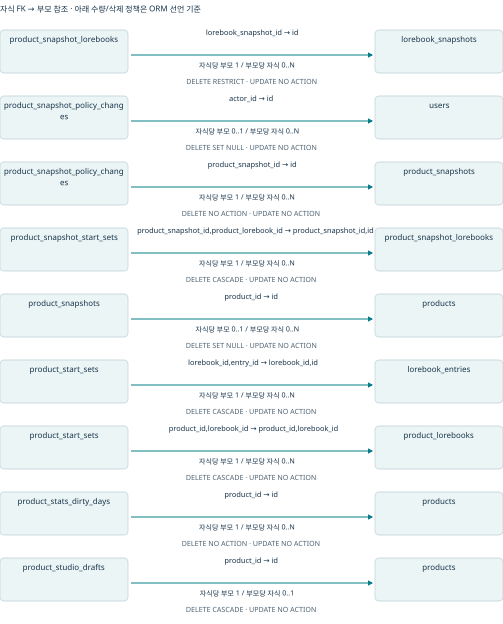

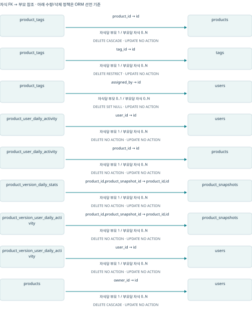

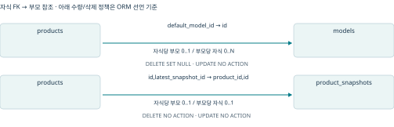

## content/tag 관계

소유 테이블: tags.

이 도메인은 물리 FK가 없다.

## 물리 FK와 논리적 참조의 차이

| 연결 | 의미 / 검증 책임 |
| --- | --- |
| character_media.owner_id / character_id | 정리·복구 기록 보존을 위해 cascade FK가 없다. 업로드와 첨부 service가 실제 소유권 검증. |
| moderation target_id / domain_action_id | 다형 대상·과거 보존 식별자. 직접 FK가 아니며 대상 공개 서비스로 확인. |
| billing quote의 모델·작품 실행 snapshot | 발급 당시 사실 보존. 현재 카탈로그를 JOIN해서 과거 값을 재작성하지 않음. |
| credit reference_id / result_id | 호출자가 공급하는 업무 식별자. credit은 의미나 타 도메인의 존재를 조회하지 않음. |
| snapshot JSON 및 generation prompt 원문 | 행의 FK와 별개로 본문 불변성은 애플리케이션 계약. DB 직접 UPDATE 방지 트리거가 있는 것은 아님. |
| tag 연결 | 현재 태그 이름이 바뀌면 조회에 반영. 발행 snapshot으로 복사되지 않음. |

## 마이그레이션 경로와 대조

Alembic은 0001 고정 baseline부터 revision 체인으로 적용하며 현재 head는 0030이다. 새 DB 초기화는 infra/postgres/init SQL 경로다. ORM create_all은 테스트용 현재 스키마 생성이며 운영 업그레이드를 대체하지 않는다. 초기화 SQL과 Alembic을 같은 기존 DB에 무조건 겹쳐 적용해서는 안 된다.

0030 generation_prompts의 고정 SQL과 초기 SQL 020은 byte 비교로 대조하고 결과를 schema-comparison.json에 남겼다. 0027 검수 DDL도 대응 초기 SQL과 대조한다. 0029 태그는 기존 kind 제거 및 다중 모듈 연결로 전환하므로 과거 DDL과 단순 파일 동일성을 요구할 수 없다. 전 revision의 실제 upgrade·downgrade 및 CHECK/인덱스/기본값 동일성은 PostgreSQL 실행 없이는 확정하지 못했다.

근거: apps/api/alembic/env.py:1; apps/api/alembic/versions/0030_generation_prompts.py:1; apps/api/tests/test_product_migrations.py:1; apps/api/tests/conftest.py:1

# 8. API와 보안 경계

| 경로군 | 인증 / 인가 / 주의점 |
| --- | --- |
| /auth/* | AuthRoute의 rate limit·CSRF·Origin·안전한 오류; access/refresh HttpOnly 쿠키 |
| /products/catalog, /products/catalog/{id} | 익명 조회. 목록은 approved+public+현재 snapshot 만료 제외; 상세는 기존 accessible 정책(비private)을 사용. unlisted는 목록 제외와 직접 링크 접근 허용을 구분. |
| /models/available | 익명 조회(Session만 의존). 활성·종료 전 모델의 ID·이름·추론 수준 반환. 모델 조회와 유료 생성 인가는 별개. |
| /characters/me, /lorebooks/me, /products/* 편집 | 인증 owner와 경로 ID를 조합하여 서비스 소유권 검사 |
| /conversations/* /messages /answers | 소유 대화 범위. 공개 사용자 메시지 쓰기와 내부 AI 출력 쓰기 분리. revision·pending 충돌은 409. |
| /account/credits* | 인증 사용자·CREDIT 재화로 스코프. 내부 지급·구매 API가 아님. |
| /admin/tags 및 내부 태그 | identity.require_admin으로 활성 관리자 재검증. source·assigned_by를 클라이언트에서 받지 않음. |
| /admin/reporting/generation-prompts | 목록·상세에 활성 admin 검사. 목록 원문 제외; 상세 no-store. |
| 기존 character/lorebook 관리자·검수 | 전용 guard 기본 503, main에 override 없음(F02). 일반 owner 인증 연결로 자동 해결되지 않음. |

CSRF(Cross-Site Request Forgery)는 브라우저 쿠키가 붙는 상태 변경 요청을 다른 사이트가 유도하는 공격이다. 이 코드에서는 Origin 허용 목록과 서명된 CSRF cookie/header 일치를 확인한다. 인증 엔드포인트는 누락 Origin도 거절한다. 일반 쿠키 인증 상태 변경도 middleware에서 검사한다. 프록시 신뢰 범위와 TLS 설정은 실제 배포에서 별도로 검증해야 한다.

오류 계약: 인증은 {error:{code}}, 일반 HTTPException은 {detail}, 입력 검증은 FastAPI 422 구조가 기본이다. 인증 DTO 오류는 비밀번호·토큰 입력이 반사되지 않도록 변환된다. 다른 업무의 입력/예외 로그 전체가 같은 보장을 갖는다고 추정하지 않는다.

근거: apps/api/app/modules/identity/http_security.py:91 (verify_csrf); apps/api/app/modules/identity/http_security.py:111 (error_response); apps/api/app/modules/identity/settings.py:12 (AuthSettings); apps/api/app/modules/reporting/operations_reporting/router.py:1

민감한 최종 프롬프트에는 캐릭터·로어·기억·대화 원문이 들어간다. 현재 원문 조회는 관리자 전용으로 제한되지만, 운영 보존기간·삭제 요청·조회 감사 정책은 별도의 결정이 필요하다. 본 보고서는 실데이터를 수집하지 않았고 규제 준수 여부를 판단하지 않는다.

# 9. 정합성·동시성·실패 처리

| 경계 | 보장과 한계 |
| --- | --- |
| use_case_transaction | 같은 session.info 표식이면 참여. 중첩 실패를 외부에서 잡아도 rollback-only. 기존 AUTOBEGIN을 임의 채택하지 않음. |
| 멱등성 | DB advisory lock은 아직 행이 없는 요청도 직렬화. UNIQUE만으로 입력 동일성을 증명하지 않으므로 각 서비스가 지문·필드 비교. |
| 메시지 | conversation FOR UPDATE, position 순서, expected_revision. rewind 이후 receipt를 재생성 허가로 사용하지 않음. |
| 답변 | 예약 commit→LLM→staging→최종 commit. 실행 token/lease로 늦은 staging 차단. 공급자 성공과 DB 저장 사이에는 불확실 구간 존재. |
| 크레딧 | wallet lock→예약/balance 쓰기. free/paid 배분 보존. 원장 header/entry/잔액 누계는 애플리케이션과 통합 검증 책임. |
| 발행 | 동일 DB transaction으로 component snapshot·상품 snapshot·release·receipt 저장. 외부 파일은 이미 준비되어야 함. |
| 미디어 | 외부 작업 종료까지 row lock 유지. 프로세스 중단 뒤 pending/deleting에서 재개. DB+S3 원자성 보장 아님. |
| 기억 | 출처 revision/digest와 unique로 저장 충돌 방어. lease 재claim은 외부 호출 중복 방지와 별개. |
| 통계 | dirty day 재집계; 실패 rollback으로 작업 유지. reporting의 여러 SELECT는 고정 snapshot 보장 안 함. |

잠금 순서 검토 시 단일 파일만 보면 안 된다. 답변은 conversation→generation과 billing request→credit wallet의 순서를 조합하고, 발행은 product→정렬된 source를 사용한다. 공유 트랜잭션에서 이미 수행한 조회가 AUTOBEGIN을 시작했는지 확인해야 한다. DB deadlock과 serialization failure의 실제 빈도는 이번 검토로 측정하지 않았다.

근거: apps/api/app/db/transaction.py:14 (use_case_transaction); apps/api/app/db/idempotency.py:8 (lock_key); apps/api/app/modules/commerce/credit/service/command.py:24 (_require_credit_transaction); apps/api/app/modules/commerce/billing/service/credits.py:79 (reserve_credit)

# 10. 테스트와 운영 관측

이번 실행의 전체 결과는 529 통과·4 실패·290 건너뜀이다. DB 및 실제 공급자 설정을 의도적으로 제거했으므로 PostgreSQL 잠금·실제 SQL·마이그레이션·외부 SDK 통신을 검증하지 않았다. 건너뜀은 성공이 아니다. 전체 항목과 사유는 tests.xml에 있다.

| 실패 테스트 | 직접 실패 원인 / 해석 |
| --- | --- |
| catalog_title_and_description… | fixture는 snapshot_data.product.title, 현재 발행/mapper는 snapshot_data.title. fixture 형태 불일치; 실제 발행본 오류로 바로 단정할 수 없음. |
| edit_after_first_publication… | 불완전 SimpleNamespace에 product_id가 없어 mapper에서 실패. 테스트는 과거 수정 금지 계약을 기대; 현재 구현은 새 초안 저장 후 후속 발행. |
| same_revision_publication_retry… | 삭제된 publication.ProductQuery를 monkeypatch하려다 AttributeError. 본문 검증 전 실패. |
| initial_publication_uses_one… | 같은 ProductQuery 참조로 setup 실패. 현재 원자성 검증 완료를 의미하지 않음. |

기존 계약 테스트 10개는 모듈 간 공개 경계, ORM 접근 제한, credit 소유권, OpenAPI 기준을 검사한다. 다만 OpenAPI 검사는 app.main 전체 HTTP 조립 대신 modules의 router를 수집한다. app/http의 catalog 상세·account·studio 조립은 별도 테스트를 함께 봐야 한다. AST는 별칭·동적 호출 전체를 증명하는 정적 분석기는 아니다.

Ruff는 61건을 보고했다. 포맷·import 정렬·테스트 표현 및 예외 정책이 섞여 있다. 자동 수정은 수행하지 않았다. 답변 복구의 except Exception은 “외부 작업을 재실행하지 않고 durable 상태를 조회”하려는 의도가 있으므로 모두 동일한 버그로 분류하지 않았다. Alembic heads는 0030 단일 head를 확인했다.

운영 관측 보완 제안: 답변 pending/lease 만료와 recovery 실패 수, 크레딧 RESERVED 장기 체류, memory job age/attempts, 미디어 pending/deleting 장기 체류, 통계 dirty 날짜를 모니터링 지표로 잡는다. 구조화 로그는 존재하지만 전체 요청 correlation ID, readiness, 정리 작업 실행 주기를 이번 코드만으로 운영 적용 완료라고 확인할 수 없다.

근거: apps/api/tests/test_architecture_contracts.py:46 (test_openapi_contract_is_unchanged); apps/api/app/main.py:185 (recover); apps/api/app/memory_worker.py:79 (run_worker); apps/api/app/modules/content/product/statistics_job.py:1

# 11. 발견 사항과 개선 순서

P2는 특정 정상 사용 조건에서 기능 오류 또는 검증 공백을 만드는 항목, P3는 유지보수 위험이다. 운영 장애·유출이 관찰되지 않은 항목을 P0/P1로 올리지 않았다. 서로 다른 신뢰 수준의 근거를 각 항목에 명시했다.

## F01 · 시작 옵션 제목의 nullable 계약 불일치

| 항목 | 내용 |
| --- | --- |
| 유형 / 심각도 | P2 · 버그 |
| 우선순위 | 즉시 수정 |
| 발생 조건 | start_set 로어의 title=None이 생성·발행 검증을 통과하고 snapshot title도 nullable인데 StartOptionInfoResponseDto.title은 str이다. |
| 영향 | 공개 작품 상세의 응답 변환에서 ValidationError가 발생할 수 있다. 일반 입력으로 만들어진 발행본을 읽지 못하는 조건부 오류다. |
| 수정 방향 | 원본의 nullable 계약을 유지하려면 시작 옵션에 한정한 표시 fallback 또는 DTO nullable 정책을 명확히 정하고 기존 소비자와 맞춘다. |
| 수정 후 검증 | 제목 없는 start_set 생성→발행→공개 상세를 실제 PostgreSQL+HTTP로 검증하고 기존 title 있는 응답도 비교한다. |
| 확인 수준 / 한계 | 합성 입력으로 entry 검증 통과·응답 ValidationError 재현. DB 발행 E2E 미실행. |

근거: apps/api/app/modules/content/lorebook/service/command.py:40 (_validate_lorebook_entry); apps/api/app/modules/content/product/service/command/settings.py:79 (_validate_publication); apps/api/app/modules/content/product/repository/publication.py:111 (add_snapshot_start); apps/api/app/modules/content/product/schemas.py:121 (StartOptionInfoResponseDto)

## F02 · 관리자·검수 전용 인증 가드가 기본 앱에 연결되지 않음

| 항목 | 내용 |
| --- | --- |
| 유형 / 심각도 | P2 · 버그 |
| 우선순위 | 노출 전 즉시 수정 |
| 발생 조건 | character/lorebook admin 및 moderator 함수는 항상 503을 내며 create_app의 override 목록은 owner/DB hook만 포함한다. |
| 영향 | 일반 사용자 인증이 작동해도 기존 전역 조회·검수 API를 정상 사용할 수 없다. 거절 기본값이므로 인증 우회 취약점으로 분류하지 않는다. |
| 수정 방향 | 역할 정책을 정하고 identity 공개 서비스에 연결하거나 미지원 경로를 명시적으로 비활성화한다. 가드를 무조건 통과시키는 수정은 피한다. |
| 수정 후 검증 | 기본 create_app 경로에서 비인증/일반/관리자/검수자별 401·403·성공 및 도메인 호출 차단을 검증한다. |
| 확인 수준 / 한계 | 합성 가드 호출에서 503, 앱 override 부재 확인. 실제 배포의 별도 override는 미확인. |

근거: apps/api/app/http/character_dependencies.py:37 (require_character_admin); apps/api/app/http/lorebook_dependencies.py:35 (require_lorebook_moderator); apps/api/app/main.py:64 (create_app)

## F03 · 검수자 ID가 대상 콘텐츠의 소유자 필터로 사용됨

| 항목 | 내용 |
| --- | --- |
| 유형 / 심각도 | P2 · 버그 |
| 우선순위 | F02 연결과 함께 수정 |
| 발생 조건 | 검수 mapper가 인증된 행위자 ID를 owner_id에 넣고 change_character_status/change_lorebook_status가 소유자 조회로 대상을 제한한다. |
| 영향 | 전용 guard를 연결해도 다른 사용자의 콘텐츠를 검수하면 404가 될 수 있다. 현재 기본 503이 먼저 발생해 경로가 가려져 있다. |
| 수정 방향 | actor_id와 대상 ID를 분리한 관리자/검수 command를 정의하고 서비스에서 역할 및 대상 상태 전이를 검증한다. 일반 소유자 update 권한을 넓히지 않는다. |
| 수정 후 검증 | A 소유 콘텐츠에 관리자 B의 승인/거절 성공, 일반 C 거절, 삭제된 대상 404, 감사행위자 B 보존을 검증한다. |
| 확인 수준 / 한계 | character 경로의 mapper→service repository 인자 합성 재현. lorebook은 동일 구조 정적 확인. |

근거: apps/api/app/modules/governance/moderation/mapper/character.py:9 (change_character_status_request_to_command); apps/api/app/modules/content/character/service/command.py:70 (change_character_status); apps/api/app/modules/content/lorebook/service/command.py:148 (change_lorebook_status)

## F04 · 중복 기본 이미지/감정 태그 제약이 일반 업무 오류로 변환되지 않음

| 항목 | 내용 |
| --- | --- |
| 유형 / 심각도 | P2 · 버그 |
| 우선순위 | 다음 개선 |
| 발생 조건 | 두 번째 is_default=True 이미지 또는 동일 emotion_tag 추가 시 create_media_attachment는 INSERT/flush하며 부분 UNIQUE·UNIQUE가 충돌한다. router는 LookupError/ValueError만 주로 변환한다. |
| 영향 | 정합성은 DB가 보호하지만 예상 가능한 사용자 충돌이 500 계열로 전달될 수 있다. 기존 기본 이미지를 바꾸는 set_default 경로와 의미가 다르다. |
| 수정 방향 | 같은 캐릭터 잠금 안에서 업무 정책을 정하고 충돌을 409/422로 변환한다. 기존 기본값 해제 여부도 명시한다. |
| 수정 후 검증 | 실제 PostgreSQL에서 연속·동시 기본 이미지 추가, 감정 태그 중복, managed binding rollback을 검증한다. |
| 확인 수준 / 한계 | DDL와 호출 경로 정적 확인; PostgreSQL HTTP 재현 미실행. |

근거: apps/api/app/db/models/character.py:78 (CharacterImage); apps/api/app/modules/content/character/service/media.py:260 (_attach_character_media); apps/api/app/modules/content/character/repository.py:691 (create_media_attachment); apps/api/app/modules/content/character/router.py:33 (_service_errors)

## F05 · 현재 스튜디오·카탈로그 변경과 회귀 테스트가 불일치

| 항목 | 내용 |
| --- | --- |
| 유형 / 심각도 | P2 · 유지보수 |
| 우선순위 | 즉시 수정 |
| 발생 조건 | 기존 전체 suite에서 4개 실패. fixture snapshot 구조·필수 필드·삭제된 import alias가 현재 코드와 다르다. |
| 영향 | 회귀 신호를 신뢰하기 어렵고 발행 원자성·재전송 검사가 실행 본문에 도달하지 못한다. 운영 버그 4개가 확인됐다는 뜻은 아니다. |
| 수정 방향 | 현재 공개 계약 기준으로 대역을 재작성하고 세부 내부 alias 대신 공개 경계로 검증한다. 후속 발행이 의도된 변경인지 문서와 테스트를 함께 맞춘다. |
| 수정 후 검증 | 전체 suite 0 실패와 실제 PostgreSQL test_repository_workflows·발행/과금 회귀를 실행한다. |
| 확인 수준 / 한계 | 이번 실행 4 failed/529 passed/290 skipped로 확인. |

근거: apps/api/tests/test_product_catalog_page.py:16 (test_catalog_title_and_description_come_from_published_snapshot); apps/api/tests/test_studio_draft_guard.py:15 (test_edit_after_first_publication_does_not_change_product_visibility); apps/api/tests/test_studio_publication.py:79 (test_initial_publication_uses_one_composed_transaction)

## F06 · ARCHITECTURE와 현재 공개 기능의 설명이 어긋남

| 항목 | 내용 |
| --- | --- |
| 유형 / 심각도 | P3 · 유지보수 |
| 우선순위 | 다음 개선 |
| 발생 조건 | product/use_cases는 후속 발행 미지원이라고 설명하지만 현재 revision receipt와 후속 편집·발행 코드가 있다. lorebook/prompt는 manual·배치·예산 설명이 새 activation 구현을 반영하지 못한다. |
| 영향 | 새 코드를 검토할 때 잘못된 전제로 영향 범위를 판단하거나 이미 구현된 기능을 다시 생성할 수 있다. |
| 수정 방향 | 현행 계약과 과거 이력을 분리하고 새 공개 인터페이스 변경 시 ARCHITECTURE 갱신을 완료 조건으로 둔다. |
| 수정 후 검증 | 문서의 파일 경로·함수와 실제 구현의 대응을 확인하고 대표 흐름 테스트 링크를 갱신한다. |
| 확인 수준 / 한계 | 문서/코드 대조 확인. 원본 문서는 수정하지 않음. |

근거: apps/api/app/modules/content/product/ARCHITECTURE.md:1; apps/api/app/use_cases/ARCHITECTURE.md:1; apps/api/app/modules/content/lorebook/ARCHITECTURE.md:1; apps/api/app/modules/content/lorebook/service/activation.py:54 (diagnose_entries); apps/api/app/use_cases/studio_publication.py:103 (publish_studio)

## F07 · memory lease 만료 이후 외부 작업이 중복될 수 있음

| 항목 | 내용 |
| --- | --- |
| 유형 / 심각도 | P2 · 성능 |
| 우선순위 | 장기 작업 운영 전 개선 |
| 발생 조건 | worker는 기본 300초 lease로 claim하고 heartbeat 갱신이 없다. 작업 전체의 강제 상한이 lease보다 짧음을 보장하는 공통 경계도 없다. |
| 영향 | 요약/임베딩 지연이 lease를 넘으면 다른 worker가 같은 대화를 재claim해 공급자 호출을 중복할 수 있다. UNIQUE·revision 검증은 저장 정합성과 별개이며 외부 비용을 되돌리지 못한다. |
| 수정 방향 | 작업별 실행 token/lease 갱신과 종료 조건, 또는 보수적인 전체 timeout을 설계한다. 외부 성공 후 저장 실패 복구도 함께 다룬다. |
| 수정 후 검증 | 2 worker에서 공급자 대역을 lease 이상 지연시키고 호출 횟수·오래된 worker 저장 차단·회수 가능성을 검증한다. |
| 확인 수준 / 한계 | 정적 조건부 위험. 다중 worker·실제 지연 재현 미실행. |

근거: apps/api/app/memory_worker.py:79 (run_worker); apps/api/app/modules/chatting/memory/repository.py:355 (claim_memory_work); apps/api/app/modules/chatting/chat/service/workflow/memory.py:79 (_process_memory_work)

권장 순서: F05로 신뢰할 수 있는 회귀 기준을 먼저 회복하면서 F01의 공개 응답 결함을 수정한다. 운영 관리자/검수 경로를 사용할 계획이면 F02와 F03을 하나의 권한 계약 변경으로 처리한다. 이후 F04, 문서 갱신 F06, 장시간 worker 조건 F07을 진행한다. 전체 구조의 일괄 재작성보다 작은 공개 계약 단위로 검증하는 편이 적합하다.

# 12. 향후 코드 검토 체크리스트

- 새 파일을 만들기 전에 해당 모듈의 책임과 소유 테이블을 확인했는가?

- 다른 모듈의 repository·mapper·ORM 대신 공개 service/types만 사용하는가?

- router가 받은 owner/actor는 검증된 인증 dependency에서 왔는가? 역할과 소유권은 구분했는가?

- 공개 Command·Info·DTO의 nullable·범위·enum이 저장 제약과 일치하는가?

- 최상위 transaction과 중첩 참여 방식, AUTOBEGIN·SAVEPOINT 차이를 확인했는가?

- 동일 요청키·다른 입력·응답 유실·동시 요청 시 의미가 명시되어 있는가?

- DB와 외부 호출 사이의 불확실 상태, 취소, lease 복구를 설명할 수 있는가?

- 원본 편집이 발행 snapshot·과거 청구·프롬프트 이력을 바꾸지 않는가?

- 테스트가 현재 공개 계약을 검증하는가? setup에서 실패하거나 DB skip을 성공으로 보고하지 않는가?

- OpenAPI·HTTP 조립 경로·기존 응답 필드와 dependency override 계약을 확인했는가?

- 로그/오류에 원문·토큰·바인드 값이 노출되지 않는가?

- ARCHITECTURE.md·ERD·마이그레이션 양 경로·운영 진입점 문서를 갱신했는가?

# 부록 A. 전체 API 목록

실제 create_app의 중첩 router prefix를 합산하여 추출했다. 각 dependency는 함수명 기준이고 서비스 내부의 추가 권한 검사는 별도다. 세부 필드·상태 코드는 현재 schema와 테스트를 확인한다. CSV는 기계 처리용 전체 목록이다.

## /auth

| 메서드 / 경로 | 진입 함수 / 의존성 |
| --- | --- |
| GET /auth/csrf | get_csrf; 없음 |
| POST /auth/register | register_user; 없음 |
| POST /auth/email/resend | resend_email; 없음 |
| POST /auth/email/verify | verify_email; 없음 |
| POST /auth/password/reset/request | request_password_reset; 없음 |
| POST /auth/password/reset | reset_password; 없음 |
| POST /auth/login | login_user; 없음 |
| POST /auth/refresh | refresh_session; 없음 |
| POST /auth/logout | logout_session; 없음 |
| POST /auth/logout-all | logout_all_sessions; 없음 |
| GET /auth/me | get_current_user; 없음 |
| POST /auth/google/start | start_google_login; 없음 |
| GET /auth/google/callback | complete_google_login; 없음 |

원본: apps/api/app/modules/identity/router.py

## /account

| 메서드 / 경로 | 진입 함수 / 의존성 |
| --- | --- |
| GET /account/overview-counts | read_counts; get_product_session, get_current_owner_id |
| GET /account/credits/transactions | list_credit_transactions; get_product_session, get_current_owner_id |
| GET /account/credits | read_credits; get_product_session, get_current_owner_id |

원본: apps/api/app/http/account_credits.py

## /characters

| 메서드 / 경로 | 진입 함수 / 의존성 |
| --- | --- |
| POST /characters/{character_id}/media/uploads | upload_character_media; get_current_owner_id, get_character_media_service |
| GET /characters/media/{media_id}/content | read_character_media; get_current_owner_id, get_character_media_service |
| GET /characters/me | list_my_characters; get_current_owner_id, get_character_session |
| GET /characters/me/{character_id} | get_my_character; get_current_owner_id, get_character_session |
| POST /characters | create_character; get_current_owner_id, get_character_session |
| PUT /characters | update_character; get_current_owner_id, get_character_session |
| DELETE /characters | delete_character; get_current_owner_id, get_character_session |
| POST /characters/images | add_character_image; get_current_owner_id, get_character_session |
| PATCH /characters/images/default | set_default_character_image; get_current_owner_id, get_character_session |
| DELETE /characters/images | delete_character_image; get_current_owner_id, get_character_session |
| POST /characters/assets | add_character_asset; get_current_owner_id, get_character_session |
| DELETE /characters/assets | delete_character_asset; get_current_owner_id, get_character_session |
| GET /characters/me/{target_id}/tags | list_public_tags; get_character_session, get_current_owner_id |
| POST /characters/me/{target_id}/tags | add_public_tags; get_character_session, get_current_owner_id |
| PUT /characters/me/{target_id}/tags | replace_public_tags; get_character_session, get_current_owner_id |
| DELETE /characters/me/{target_id}/tags/{tag_id} | remove_public_tag; get_character_session, get_current_owner_id |
| GET /characters | list_characters; require_character_admin, get_character_session |
| GET /characters/{character_id} | get_character; require_character_admin, get_character_session |
| PATCH /characters/status | change_character_status; require_character_moderator, get_current_owner_id, get_character_session |

원본: apps/api/app/http/media.py, apps/api/app/modules/content/character/router.py, apps/api/app/modules/content/character/tag_router.py, apps/api/app/modules/governance/admin/character_router.py, apps/api/app/modules/governance/moderation/character_router.py

## /lorebooks

| 메서드 / 경로 | 진입 함수 / 의존성 |
| --- | --- |
| GET /lorebooks/me | list_my_lorebooks; get_current_owner_id, get_lorebook_session |
| GET /lorebooks/me/{lorebook_id} | get_my_lorebook; get_current_owner_id, get_lorebook_session |
| GET /lorebooks/me/{lorebook_id}/entries | list_my_lorebook_entries; get_current_owner_id, get_lorebook_session |
| GET /lorebooks/me/{lorebook_id}/entries/{entry_id} | get_my_lorebook_entry; get_current_owner_id, get_lorebook_session |
| POST /lorebooks | create_lorebook; get_current_owner_id, get_lorebook_session |
| PUT /lorebooks | update_lorebook; get_current_owner_id, get_lorebook_session |
| DELETE /lorebooks | delete_lorebook; get_current_owner_id, get_lorebook_session |
| POST /lorebooks/entries | create_lorebook_entry; get_current_owner_id, get_lorebook_session |
| PUT /lorebooks/entries | update_lorebook_entry; get_current_owner_id, get_lorebook_session |
| DELETE /lorebooks/entries | delete_lorebook_entry; get_current_owner_id, get_lorebook_session |
| GET /lorebooks/me/{target_id}/tags | list_public_tags; get_lorebook_session, get_current_owner_id |
| POST /lorebooks/me/{target_id}/tags | add_public_tags; get_lorebook_session, get_current_owner_id |
| PUT /lorebooks/me/{target_id}/tags | replace_public_tags; get_lorebook_session, get_current_owner_id |
| DELETE /lorebooks/me/{target_id}/tags/{tag_id} | remove_public_tag; get_lorebook_session, get_current_owner_id |
| GET /lorebooks | list_lorebooks; require_lorebook_admin, get_lorebook_session |
| GET /lorebooks/{lorebook_id} | get_lorebook; require_lorebook_admin, get_lorebook_session |
| GET /lorebooks/{lorebook_id}/entries | list_entries; require_lorebook_admin, get_lorebook_session |
| GET /lorebooks/{lorebook_id}/entries/{entry_id} | get_entry; require_lorebook_admin, get_lorebook_session |
| PATCH /lorebooks/status | change_lorebook_status; require_lorebook_moderator, get_current_owner_id, get_lorebook_session |

원본: apps/api/app/modules/content/lorebook/router.py, apps/api/app/modules/content/lorebook/tag_router.py, apps/api/app/modules/governance/admin/lorebook_router.py, apps/api/app/modules/governance/moderation/lorebook_router.py

## /products

| 메서드 / 경로 | 진입 함수 / 의존성 |
| --- | --- |
| GET /products/{product_id}/versions/{snapshot_id}/media/{media_id}/content | read_product_media; get_current_owner_id, get_product_media_service |
| GET /products/catalog/{product_id} | get_catalog_product; get_product_session |
| PUT /products/{product_id}/studio-draft | write_studio_draft; get_product_session, get_current_owner_id |
| POST /products/studio/lore-diagnostics | diagnose_lore; get_current_owner_id |
| POST /products/{product_id}/studio-components | prepare_studio_components; get_product_session, get_current_owner_id |
| POST /products/{product_id}/studio-publication | publish_studio_draft; get_product_session, get_current_owner_id |
| GET /products/{product_id}/studio-draft | read_studio_draft; get_product_session, get_current_owner_id |
| GET /products/catalog | catalog; get_product_session |
| GET /products/catalog-tags | catalog_tags; get_product_session |
| GET /products/mine | list_mine; get_product_session, get_current_owner_id |
| GET /products/mine/count | count_mine; get_product_session, get_current_owner_id |
| POST /products | create; get_product_session, get_current_owner_id |
| GET /products/{product_id}/draft | get_draft; get_product_session, get_current_owner_id |
| PUT /products/{product_id}/draft | update; get_product_session, get_current_owner_id |
| DELETE /products/{product_id}/draft | delete; get_product_session, get_current_owner_id |
| PUT /products/{product_id}/composition | put_composition; get_product_session, get_current_owner_id |
| GET /products/{product_id}/composition | read_composition; get_product_session, get_current_owner_id |
| PUT /products/{product_id}/settings | put_settings; get_product_session, get_current_owner_id |
| POST /products/{product_id}/releases | publish; get_product_session, get_current_owner_id |
| PATCH /products/{product_id}/releases/{snapshot_id}/note | correct_note; get_product_session, get_current_owner_id |
| GET /products/{product_id} | published; get_product_session, get_current_owner_id |
| GET /products/{product_id}/statistics | statistics; get_product_session, get_current_owner_id |
| GET /products/{product_id}/releases/{snapshot_id}/availability | version_availability; get_product_session, get_current_owner_id |
| GET /products/{target_id}/tags | list_public_tags; get_product_session, get_current_owner_id |
| POST /products/{target_id}/tags | add_public_tags; get_product_session, get_current_owner_id |
| PUT /products/{target_id}/tags | replace_public_tags; get_product_session, get_current_owner_id |
| DELETE /products/{target_id}/tags/{tag_id} | remove_public_tag; get_product_session, get_current_owner_id |

원본: apps/api/app/http/media.py, apps/api/app/http/public_catalog.py, apps/api/app/http/studio_publication.py, apps/api/app/modules/content/product/router.py, apps/api/app/modules/content/product/tag_router.py

## /conversations

| 메서드 / 경로 | 진입 함수 / 의존성 |
| --- | --- |
| GET /conversations/mine | list_mine; get_product_session, get_current_owner_id |
| GET /conversations/{conversation_id}/manual-lore | manual_lore; get_product_session, get_current_owner_id |
| POST /conversations | start; get_product_session, get_current_owner_id |
| GET /conversations/{conversation_id}/updates | updates; get_product_session, get_current_owner_id |
| POST /conversations/{conversation_id}/version | switch; get_product_session, get_current_owner_id |
| GET /conversations/{conversation_id}/start | get_start; get_product_session, get_current_owner_id |
| POST /conversations/{conversation_id}/messages | create_message; get_product_session, get_current_owner_id |
| GET /conversations/{conversation_id}/messages | list_messages; get_product_session, get_current_owner_id |
| PUT /conversations/{conversation_id}/messages/{message_id} | replace_message; get_product_session, get_current_owner_id |
| DELETE /conversations/{conversation_id}/messages/{message_id} | rewind_messages; get_product_session, get_current_owner_id |
| POST /conversations/{conversation_id}/answers | generate_answer; get_current_owner_id, get_answer_orchestrator |

원본: apps/api/app/http/conversation_directory.py, apps/api/app/modules/chatting/chat/router/answers.py, apps/api/app/modules/chatting/chat/router/messages.py, apps/api/app/modules/chatting/conversation/router.py

## /admin

| 메서드 / 경로 | 진입 함수 / 의존성 |
| --- | --- |
| PUT /admin/models/{model_id}/retirement | announce; get_product_session, get_current_owner_id |
| PUT /admin/products/versions/{snapshot_id}/expiry | expiry; get_product_session, get_current_owner_id |
| PUT /admin/products/{product_id}/status | status; get_product_session, get_current_owner_id |
| GET /admin/products/{target_id}/internal-tags | list_product_internal_tags; get_product_session, get_current_owner_id |
| POST /admin/products/{target_id}/internal-tags | add_product_internal_tags; get_product_session, get_current_owner_id |
| PUT /admin/products/{target_id}/internal-tags | replace_product_internal_tags; get_product_session, get_current_owner_id |
| DELETE /admin/products/{target_id}/internal-tags/{tag_id} | remove_product_internal_tag; get_product_session, get_current_owner_id |
| GET /admin/characters/{target_id}/internal-tags | list_character_internal_tags; get_product_session, get_current_owner_id |
| POST /admin/characters/{target_id}/internal-tags | add_character_internal_tags; get_product_session, get_current_owner_id |
| PUT /admin/characters/{target_id}/internal-tags | replace_character_internal_tags; get_product_session, get_current_owner_id |
| DELETE /admin/characters/{target_id}/internal-tags/{tag_id} | remove_character_internal_tag; get_product_session, get_current_owner_id |
| GET /admin/lorebooks/{target_id}/internal-tags | list_lorebook_internal_tags; get_product_session, get_current_owner_id |
| POST /admin/lorebooks/{target_id}/internal-tags | add_lorebook_internal_tags; get_product_session, get_current_owner_id |
| PUT /admin/lorebooks/{target_id}/internal-tags | replace_lorebook_internal_tags; get_product_session, get_current_owner_id |
| DELETE /admin/lorebooks/{target_id}/internal-tags/{tag_id} | remove_lorebook_internal_tag; get_product_session, get_current_owner_id |
| GET /admin/tags/{tag_id} | get_tag; get_product_session, get_current_owner_id |
| POST /admin/tags | create_tag; get_product_session, get_current_owner_id |
| PUT /admin/tags/{tag_id} | update_tag; get_product_session, get_current_owner_id |
| DELETE /admin/tags/{tag_id} | deactivate_tag; get_product_session, get_current_owner_id |
| GET /admin/reporting/generation-prompts | list_generation_prompts; get_product_session, get_current_owner_id |
| GET /admin/reporting/generation-prompts/{generation_id} | get_generation_prompt; get_product_session, get_current_owner_id |

원본: apps/api/app/modules/governance/admin/model_router.py, apps/api/app/modules/governance/admin/product_router.py, apps/api/app/modules/governance/admin/tag_router.py, apps/api/app/modules/reporting/operations_reporting/router.py

## /models

| 메서드 / 경로 | 진입 함수 / 의존성 |
| --- | --- |
| GET /models/available | available_models; get_product_session |

원본: apps/api/app/http/model_catalog.py

# 부록 B. 전체 테이블 사전

각 표는 현재 ORM의 모든 컬럼을 포함한다. PK=기본키, NULL=선택값, UQ=유일 제약. UUID·생성시각 기본값 등은 schema.json의 server default를 참조한다. 제약·인덱스는 실제 이름과 컬럼을 기록하되 길이가 긴 CHECK 식은 schema.json에 원문을 보존했다. UPDATE 정책은 FK 그림 및 relationships.csv에 있다.

## governance/moderation 테이블

### audit_logs

근거: apps/api/app/db/models/moderation.py:61 (AuditLog)

| 컬럼 | 타입 | 제약 |
| --- | --- | --- |
| admin_id | UUID | NOT NULL |
| action | TEXT | NOT NULL |
| target_id | UUID | NULL |
| metadata | JSONB | NOT NULL |
| created_at | DATETIME | NOT NULL |
| id | UUID | PK NOT NULL |

- INDEX ix_audit_logs_admin_id_created_at (audit_logs.admin_id, audit_logs.created_at)

- INDEX ix_audit_logs_action_created_at (audit_logs.action, audit_logs.created_at)

FK: admin_id → users(id), DELETE RESTRICT

### moderation_actions

근거: apps/api/app/db/models/moderation_review.py:188 (ModerationAction)

| 컬럼 | 타입 | 제약 |
| --- | --- | --- |
| assessment_id | UUID | NOT NULL |
| target_type | TEXT | NOT NULL |
| target_id | UUID | NOT NULL |
| action_type | TEXT | NOT NULL |
| scope | TEXT | NOT NULL |
| starts_at | DATETIME | NOT NULL |
| ends_at | DATETIME | NULL |
| status | TEXT | NOT NULL |
| idempotency_key | UUID | NOT NULL |
| domain_action_id | UUID | NULL |
| reverses_action_id | UUID | NULL |
| created_at | DATETIME | NOT NULL |
| applied_at | DATETIME | NULL |
| last_error_code | TEXT | NULL |
| id | UUID | PK NOT NULL |

- CHECK ck_moderation_actions_applied: (status = 'applied') = (applied_at IS NOT NULL)

- CHECK ck_moderation_actions_not_self: reverses_action_id <> id

- CHECK ck_moderation_actions_scope: length(btrim(scope)) > 0

- CHECK ck_moderation_actions_type: action_type IN ('warn','restrict','suspend','ban','revoke')

- UQ None (idempotency_key)

- CHECK ck_moderation_actions_status: status IN ('pending','applied','failed','cancelled')

- CHECK ck_moderation_actions_reversal: (action_type = 'revoke') = (reverses_action_id IS NOT NULL)

- CHECK ck_moderation_actions_target: target_type IN ('user','product','character','message')

- CHECK ck_moderation_actions_period: ends_at IS NULL OR ends_at > starts_at

- INDEX ix_moderation_actions_assessment (moderation_actions.assessment_id)

- INDEX ix_moderation_actions_target_created (moderation_actions.target_type, moderation_actions.target_id, moderation_actions.created_at)

- INDEX ix_moderation_actions_retry (moderation_actions.status, moderation_actions.created_at) WHERE status IN ('pending','failed')

- INDEX ix_moderation_actions_reverses (moderation_actions.reverses_action_id)

FK: assessment_id → moderation_assessments(id), DELETE RESTRICT; reverses_action_id → moderation_actions(id), DELETE RESTRICT

### moderation_assessment_reports

근거: apps/api/app/db/models/moderation_review.py:170 (ModerationAssessmentReport)

| 컬럼 | 타입 | 제약 |
| --- | --- | --- |
| assessment_id | UUID | PK NOT NULL |
| report_id | UUID | PK NOT NULL |
| disposition | TEXT | NOT NULL |

- CHECK ck_moderation_assessment_reports_disposition: disposition IN ('supported','not_supported','insufficient_evidence','unassessed')

- INDEX ix_moderation_assessment_reports_report (moderation_assessment_reports.report_id)

FK: assessment_id → moderation_assessments(id), DELETE RESTRICT; report_id → moderation_reports(id), DELETE RESTRICT

### moderation_assessments

근거: apps/api/app/db/models/moderation_review.py:98 (ModerationAssessment)

| 컬럼 | 타입 | 제약 |
| --- | --- | --- |
| target_type | TEXT | NOT NULL |
| target_id | UUID | NOT NULL |
| assessment_type | TEXT | NOT NULL |
| evaluator_user_id | UUID | NULL |
| policy_version | TEXT | NOT NULL |
| evaluated_at | DATETIME | NOT NULL |
| window_start | DATETIME | NULL |
| window_end | DATETIME | NULL |
| signals | JSONB | NOT NULL |
| confidence_score | NUMERIC | NULL |
| outcome | TEXT | NOT NULL |
| violation_code | TEXT | NULL |
| severity | SMALLINT | NULL |
| recommended_actions | JSONB | NOT NULL |
| rationale | TEXT | NOT NULL |
| supersedes_assessment_id | UUID | NULL |
| evaluation_key | TEXT | NOT NULL |
| id | UUID | PK NOT NULL |

- UQ None (evaluation_key)

- CHECK ck_moderation_assessments_required_text: length(btrim(policy_version)) > 0 AND length(btrim(rationale)) > 0 AND length(btrim(evaluation_key)) > 0

- CHECK ck_moderation_assessments_signals: jsonb_typeof(signals) = 'object'

- CHECK ck_moderation_assessments_score: confidence_score BETWEEN 0 AND 1

- CHECK ck_moderation_assessments_recommendations: jsonb_typeof(recommended_actions) = 'array'

- CHECK ck_moderation_assessments_severity: severity >= 0

- CHECK ck_moderation_assessments_not_self: supersedes_assessment_id <> id

- CHECK ck_moderation_assessments_target: target_type IN ('user','product','character','message')

- CHECK ck_moderation_assessments_outcome: outcome IN ('violation','no_violation','insufficient_evidence')

- CHECK ck_moderation_assessments_window: (window_start IS NULL AND window_end IS NULL) OR (window_start IS NOT NULL AND window_end IS NOT NULL AND window_end > window_start)

- CHECK ck_moderation_assessments_type: assessment_type IN ('manual','automatic')

- INDEX ix_moderation_assessments_target_evaluated (moderation_assessments.target_type, moderation_assessments.target_id, moderation_assessments.evaluated_at)

- INDEX ix_moderation_assessments_supersedes (moderation_assessments.supersedes_assessment_id)

FK: evaluator_user_id → users(id), DELETE SET NULL; supersedes_assessment_id → moderation_assessments(id), DELETE RESTRICT

### moderation_flags

근거: apps/api/app/db/models/moderation.py:26 (ModerationFlag)

| 컬럼 | 타입 | 제약 |
| --- | --- | --- |
| target_type | TEXT | NOT NULL |
| target_id | UUID | NOT NULL |
| flagged_by | UUID | NULL |
| reason | TEXT | NOT NULL |
| status | TEXT | NOT NULL |
| reviewed_by | UUID | NULL |
| created_at | DATETIME | NOT NULL |
| reviewed_at | DATETIME | NULL |
| id | UUID | PK NOT NULL |

- CHECK ck_moderation_flags_target_type: target_type IN ('character', 'message')

- CHECK ck_moderation_flags_status: status IN ('pending', 'reviewed', 'dismissed')

- INDEX ix_moderation_flags_status_created_at (moderation_flags.status, moderation_flags.created_at)

- INDEX ix_moderation_flags_target (moderation_flags.target_type, moderation_flags.target_id)

FK: reviewed_by → users(id), DELETE SET NULL; flagged_by → users(id), DELETE SET NULL

### moderation_reports

근거: apps/api/app/db/models/moderation_review.py:26 (ModerationReport)

| 컬럼 | 타입 | 제약 |
| --- | --- | --- |
| request_key | UUID | NOT NULL |
| reporter_user_id | UUID | NULL |
| target_type | TEXT | NOT NULL |
| target_id | UUID | NOT NULL |
| target_owner_user_id | UUID | NULL |
| target_snapshot_id | UUID | NULL |
| reason_code | TEXT | NOT NULL |
| reason_detail | TEXT | NULL |
| occurred_at | DATETIME | NULL |
| received_at | DATETIME | NOT NULL |
| form_elapsed_ms | BIGINT | NULL |
| evidence_snapshot | JSONB | NOT NULL |
| attachment_refs | JSONB | NOT NULL |
| evidence_captured_at | DATETIME | NULL |
| intake_status | TEXT | NOT NULL |
| duplicate_of_report_id | UUID | NULL |
| intake_reason | TEXT | NULL |
| id | UUID | PK NOT NULL |

- CHECK ck_moderation_reports_duplicate: (intake_status = 'duplicate') = (duplicate_of_report_id IS NOT NULL)

- CHECK ck_moderation_reports_evidence: jsonb_typeof(evidence_snapshot) = 'object'

- CHECK ck_moderation_reports_reason: length(btrim(reason_code)) > 0

- CHECK ck_moderation_reports_attachments: jsonb_typeof(attachment_refs) = 'array'

- CHECK ck_moderation_reports_status: intake_status IN ('received','duplicate','rejected')

- UQ None (request_key)

- CHECK ck_moderation_reports_not_self: duplicate_of_report_id <> id

- CHECK ck_moderation_reports_elapsed: form_elapsed_ms >= 0

- CHECK ck_moderation_reports_target: target_type IN ('user','product','character','message')

- INDEX ix_moderation_reports_status_received (moderation_reports.intake_status, moderation_reports.received_at)

- INDEX ix_moderation_reports_target_received (moderation_reports.target_type, moderation_reports.target_id, moderation_reports.received_at)

- INDEX ix_moderation_reports_reporter_received (moderation_reports.reporter_user_id, moderation_reports.received_at)

FK: reporter_user_id → users(id), DELETE SET NULL; duplicate_of_report_id → moderation_reports(id), DELETE RESTRICT

## identity 테이블

### auth_action_tokens

근거: apps/api/app/db/models/identity.py:97 (AuthActionToken)

| 컬럼 | 타입 | 제약 |
| --- | --- | --- |
| user_id | UUID | NOT NULL |
| token_hash | TEXT | NOT NULL |
| purpose | TEXT | NOT NULL |
| expires_at | DATETIME | NOT NULL |
| consumed_at | DATETIME | NULL |
| id | UUID | PK NOT NULL |

- CHECK ck_auth_action_purpose: purpose IN ('verify', 'reset')

- UQ None (token_hash)

- INDEX ix_auth_action_tokens_expires_at (auth_action_tokens.expires_at)

- INDEX ix_auth_action_tokens_user_id (auth_action_tokens.user_id)

FK: user_id → users(id), DELETE CASCADE

### auth_oauth_attempts

근거: apps/api/app/db/models/identity.py:115 (AuthOAuthAttempt)

| 컬럼 | 타입 | 제약 |
| --- | --- | --- |
| state_hash | TEXT | PK NOT NULL |
| expires_at | DATETIME | NOT NULL |
| consumed_at | DATETIME | NULL |

- INDEX ix_auth_oauth_attempts_expires_at (auth_oauth_attempts.expires_at)

물리 FK 없음. 논리적 참조가 있는지는 7장의 설명을 함께 확인한다.

### auth_rate_limits

근거: apps/api/app/db/models/identity.py:124 (AuthRateLimit)

| 컬럼 | 타입 | 제약 |
| --- | --- | --- |
| key | TEXT | PK NOT NULL |
| count | INTEGER | NOT NULL |
| expires_at | DATETIME | NOT NULL |

- INDEX ix_auth_rate_limits_expires_at (auth_rate_limits.expires_at)

물리 FK 없음. 논리적 참조가 있는지는 7장의 설명을 함께 확인한다.

### auth_sessions

근거: apps/api/app/db/models/identity.py:82 (AuthSession)

| 컬럼 | 타입 | 제약 |
| --- | --- | --- |
| user_id | UUID | NOT NULL |
| refresh_hash | TEXT | NOT NULL |
| created_at | DATETIME | NOT NULL |
| expires_at | DATETIME | NOT NULL |
| revoked_at | DATETIME | NULL |
| id | UUID | PK NOT NULL |

- INDEX ix_auth_sessions_expires_at (auth_sessions.expires_at)

- INDEX ix_auth_sessions_user_id (auth_sessions.user_id)

FK: user_id → users(id), DELETE CASCADE

### user_oauth_accounts

근거: apps/api/app/db/models/identity.py:65 (UserOAuthAccount)

| 컬럼 | 타입 | 제약 |
| --- | --- | --- |
| user_id | UUID | NOT NULL |
| provider | TEXT | NOT NULL |
| provider_user_id | TEXT | NOT NULL |
| created_at | DATETIME | NOT NULL |
| updated_at | DATETIME | NOT NULL |
| id | UUID | PK NOT NULL |

- UQ uq_user_oauth_provider_user (provider, provider_user_id)

FK: user_id → users(id), DELETE CASCADE

### users

근거: apps/api/app/db/models/identity.py:35 (User)

| 컬럼 | 타입 | 제약 |
| --- | --- | --- |
| email | TEXT | NOT NULL |
| password_hash | TEXT | NULL |
| email_verified | BOOLEAN | NOT NULL |
| pending_expires_at | DATETIME | NULL |
| display_name | TEXT | NULL |
| role | TEXT | NOT NULL |
| status | TEXT | NOT NULL |
| created_at | DATETIME | NOT NULL |
| updated_at | DATETIME | NOT NULL |
| id | UUID | PK NOT NULL |

- UQ None (email)

- CHECK ck_users_role: role IN ('user', 'admin')

- CHECK ck_users_email_normalized: email = lower(btrim(email))

- CHECK ck_users_status: status IN ('active', 'suspended', 'banned')

물리 FK 없음. 논리적 참조가 있는지는 7장의 설명을 함께 확인한다.

## commerce/billing 테이블

### billing_credit_bindings

근거: apps/api/app/db/models/billing_credit.py:14 (BillingCreditBinding)

| 컬럼 | 타입 | 제약 |
| --- | --- | --- |
| reservation_id | UUID | PK NOT NULL |
| quote_id | UUID | NOT NULL |
| user_id | UUID | NOT NULL |
| request_key | UUID | NOT NULL |
| created_at | DATETIME | NOT NULL |

- UQ uq_billing_credit_bindings_quote (quote_id)

- UQ uq_billing_credit_bindings_user_request (user_id, request_key)

FK: quote_id,user_id,request_key → billing_quotes(id,user_id,request_key), DELETE RESTRICT; reservation_id,user_id,request_key → credit_reservations(id,user_id,request_key), DELETE RESTRICT

### billing_quotes

근거: apps/api/app/db/models/billing_quote.py:16 (BillingQuote)

| 컬럼 | 타입 | 제약 |
| --- | --- | --- |
| user_id | UUID | NOT NULL |
| request_key | UUID | NOT NULL |
| request_snapshot | JSONB | NOT NULL |
| price_snapshot | JSONB | NOT NULL |
| created_at | DATETIME | NOT NULL |
| expires_at | DATETIME | NOT NULL |
| id | UUID | PK NOT NULL |

- CHECK ck_billing_quotes_snapshots: jsonb_typeof(request_snapshot) = 'object' AND jsonb_typeof(price_snapshot) = 'object'

- CHECK ck_billing_quotes_expiration: expires_at > created_at

- UQ uq_billing_quotes_identity (id, user_id, request_key)

- UQ uq_billing_quotes_user_request (user_id, request_key)

FK: user_id → users(id), DELETE RESTRICT

### payments

근거: apps/api/app/db/models/billing.py:153 (Payment)

| 컬럼 | 타입 | 제약 |
| --- | --- | --- |
| user_id | UUID | NOT NULL |
| subscription_id | UUID | NULL |
| amount | NUMERIC(10, 2) | NOT NULL |
| currency | TEXT | NOT NULL |
| status | TEXT | NOT NULL |
| pg_provider | TEXT | NOT NULL |
| pg_transaction_id | TEXT | NULL |
| created_at | DATETIME | NOT NULL |
| id | UUID | PK NOT NULL |

- CHECK ck_payments_status: status IN ('pending', 'succeeded', 'failed', 'refunded')

- UQ uq_payments_pg_transaction_id (pg_transaction_id)

- INDEX ix_payments_user_id_created_at (payments.user_id, payments.created_at)

FK: subscription_id → user_subscriptions(id), DELETE SET NULL; user_id → users(id), DELETE CASCADE

### product_payment_events

근거: apps/api/app/db/models/product_usage.py:85 (ProductPaymentEvent)

| 컬럼 | 타입 | 제약 |
| --- | --- | --- |
| payment_id | UUID | NOT NULL |
| sale_id | UUID | NULL |
| product_id | UUID | NOT NULL |
| product_snapshot_id | UUID | NOT NULL |
| event_key | TEXT | NOT NULL |
| kind | TEXT | NOT NULL |
| amount | NUMERIC(20, 2) | NOT NULL |
| currency | TEXT | NOT NULL |
| occurred_at | DATETIME | NOT NULL |
| attributed_at | DATETIME | NOT NULL |
| created_at | DATETIME | NOT NULL |
| id | UUID | PK NOT NULL |

- CHECK ck_product_payment_amount: amount > 0

- CHECK ck_product_payment_kind: kind IN ('sale','refund')

- UQ uq_product_payment_event_key (event_key)

- CHECK ck_product_payment_parent: (kind='sale' AND sale_id IS NULL) OR (kind='refund' AND sale_id IS NOT NULL)

- INDEX ix_product_payment_period (product_payment_events.product_id, product_payment_events.attributed_at)

FK: sale_id → product_payment_events(id), DELETE NO ACTION; product_id → products(id), DELETE NO ACTION; product_id,product_snapshot_id → product_snapshots(product_id,id), DELETE NO ACTION; payment_id → payments(id), DELETE NO ACTION

### subscription_plans

근거: apps/api/app/db/models/billing.py:106 (SubscriptionPlan)

| 컬럼 | 타입 | 제약 |
| --- | --- | --- |
| name | TEXT | NOT NULL |
| monthly_credit | BIGINT | NOT NULL |
| price | NUMERIC(10, 2) | NOT NULL |
| billing_cycle | TEXT | NOT NULL |
| is_enabled | BOOLEAN | NOT NULL |
| id | UUID | PK NOT NULL |

- CHECK ck_subscription_plans_billing_cycle: billing_cycle IN ('monthly', 'yearly')

물리 FK 없음. 논리적 참조가 있는지는 7장의 설명을 함께 확인한다.

### usage_logs

근거: apps/api/app/db/models/billing.py:55 (UsageLog)

| 컬럼 | 타입 | 제약 |
| --- | --- | --- |
| user_id | UUID | NOT NULL |
| conversation_id | UUID | NULL |
| model_id | UUID | NOT NULL |
| input_tokens | INTEGER | NOT NULL |
| generation_id | UUID | NULL |
| product_id | UUID | NULL |
| product_snapshot_id | UUID | NULL |
| reasoning_effort | TEXT | NULL |
| output_tokens | INTEGER | NOT NULL |
| latency_ms | INTEGER | NULL |
| cost_credit | BIGINT | NOT NULL |
| created_at | DATETIME | NOT NULL |
| id | UUID | PK NOT NULL |

- UQ uq_usage_generation (generation_id)

- CHECK ck_usage_nonnegative: input_tokens >= 0 AND output_tokens >= 0 AND cost_credit >= 0

- INDEX ix_usage_logs_user_id_created_at (usage_logs.user_id, usage_logs.created_at)

- INDEX ix_usage_logs_conversation_id_created_at (usage_logs.conversation_id, usage_logs.created_at)

FK: generation_id,product_snapshot_id → product_generations(id,product_snapshot_id), DELETE NO ACTION; product_id,product_snapshot_id → product_snapshots(product_id,id), DELETE NO ACTION; user_id → users(id), DELETE CASCADE; conversation_id → conversations(id), DELETE SET NULL; model_id → models(id), DELETE RESTRICT

### user_subscriptions

근거: apps/api/app/db/models/billing.py:124 (UserSubscription)

| 컬럼 | 타입 | 제약 |
| --- | --- | --- |
| user_id | UUID | NOT NULL |
| plan_id | UUID | NOT NULL |
| status | TEXT | NOT NULL |
| current_period_start | DATETIME | NOT NULL |
| current_period_end | DATETIME | NOT NULL |
| created_at | DATETIME | NOT NULL |
| updated_at | DATETIME | NOT NULL |
| id | UUID | PK NOT NULL |

- CHECK ck_user_subscriptions_status: status IN ('active', 'canceled', 'expired', 'past_due')

- INDEX ix_user_subscriptions_user_id_status (user_subscriptions.user_id, user_subscriptions.status)

FK: plan_id → subscription_plans(id), DELETE RESTRICT; user_id → users(id), DELETE CASCADE

## content/character 테이블

### character_assets

근거: apps/api/app/db/models/character.py:109 (CharacterAsset)

| 컬럼 | 타입 | 제약 |
| --- | --- | --- |
| character_id | UUID | NOT NULL |
| asset_type | TEXT | NOT NULL |
| purpose | TEXT | NOT NULL |
| file_url | TEXT | NOT NULL |
| media_id | UUID | NULL |
| created_at | DATETIME | NOT NULL |
| updated_at | DATETIME | NOT NULL |
| id | UUID | PK NOT NULL |

- CHECK ck_character_assets_asset_type: asset_type IN ('image', 'audio', 'video')

- INDEX ix_character_assets_media_id (character_assets.media_id)

- INDEX ix_character_assets_character_id (character_assets.character_id)

FK: character_id → characters(id), DELETE CASCADE; media_id → character_media(id), DELETE RESTRICT

### character_images

근거: apps/api/app/db/models/character.py:78 (CharacterImage)

| 컬럼 | 타입 | 제약 |
| --- | --- | --- |
| character_id | UUID | NOT NULL |
| emotion_tag | TEXT | NOT NULL |
| image_url | TEXT | NOT NULL |
| media_id | UUID | NULL |
| is_default | BOOLEAN | NOT NULL |
| created_at | DATETIME | NOT NULL |
| updated_at | DATETIME | NOT NULL |
| id | UUID | PK NOT NULL |

- UQ uq_character_images_emotion (character_id, emotion_tag)

- UNIQUE INDEX uq_character_images_default_per_character (character_images.character_id) WHERE is_default = true

- INDEX ix_character_images_media_id (character_images.media_id)

FK: media_id → character_media(id), DELETE RESTRICT; character_id → characters(id), DELETE CASCADE

### character_internal_tags

근거: apps/api/app/db/models/tag.py:111 (CharacterInternalTag)

| 컬럼 | 타입 | 제약 |
| --- | --- | --- |
| character_id | UUID | PK NOT NULL |
| tag_id | UUID | PK NOT NULL |
| source | TEXT | NOT NULL |
| assigned_by | UUID | NULL |
| created_at | DATETIME | NOT NULL |
| updated_at | DATETIME | NOT NULL |

- CHECK ck_character_internal_tags_source: source IN ('admin', 'system')

- INDEX ix_character_internal_tags_tag_character (character_internal_tags.tag_id, character_internal_tags.character_id)

FK: character_id → characters(id), DELETE CASCADE; tag_id → tags(id), DELETE RESTRICT; assigned_by → users(id), DELETE SET NULL

### character_media

근거: apps/api/app/db/models/character_media.py:16 (CharacterMedia)

| 컬럼 | 타입 | 제약 |
| --- | --- | --- |
| owner_id | UUID | NOT NULL |
| character_id | UUID | NOT NULL |
| request_id | UUID | NOT NULL |
| storage_kind | TEXT | NOT NULL |
| storage_id | TEXT | NOT NULL |
| object_key | TEXT | NOT NULL |
| content_type | TEXT | NOT NULL |
| size_bytes | BIGINT | NOT NULL |
| original_filename | TEXT | NOT NULL |
| purpose | TEXT | NOT NULL |
| sha256 | TEXT | NOT NULL |
| state | TEXT | NOT NULL |
| binding | TEXT | NULL |
| created_at | DATETIME | NOT NULL |
| updated_at | DATETIME | NOT NULL |
| id | UUID | PK NOT NULL |

- CHECK ck_character_media_storage: storage_kind IN ('test_local','s3')

- UQ uq_character_media_object (storage_kind, storage_id, object_key)

- CHECK ck_character_media_size: size_bytes >= 0

- CHECK ck_character_media_state: state IN ('pending','ready','deleting','deleted')

- UQ uq_character_media_request (owner_id, character_id, request_id)

물리 FK 없음. 논리적 참조가 있는지는 7장의 설명을 함께 확인한다.

### character_snapshot_assets

근거: apps/api/app/db/models/snapshot/character.py:73 (CharacterSnapshotAsset)

| 컬럼 | 타입 | 제약 |
| --- | --- | --- |
| character_snapshot_id | UUID | NOT NULL |
| source_asset_id | UUID | NOT NULL |
| asset_type | TEXT | NOT NULL |
| purpose | TEXT | NOT NULL |
| file_url | TEXT | NOT NULL |
| media_id | UUID | NULL |
| id | UUID | PK NOT NULL |

- CHECK ck_snapshot_asset_type: asset_type IN ('image','audio','video')

- INDEX ix_character_snapshot_assets_media_id (character_snapshot_assets.media_id)

- INDEX ix_snapshot_assets_parent (character_snapshot_assets.character_snapshot_id)

FK: character_snapshot_id → character_snapshots(id), DELETE CASCADE; media_id → character_media(id), DELETE RESTRICT

### character_snapshot_images

근거: apps/api/app/db/models/snapshot/character.py:44 (CharacterSnapshotImage)

| 컬럼 | 타입 | 제약 |
| --- | --- | --- |
| character_snapshot_id | UUID | NOT NULL |
| source_image_id | UUID | NOT NULL |
| emotion_tag | TEXT | NOT NULL |
| image_url | TEXT | NOT NULL |
| media_id | UUID | NULL |
| is_default | BOOLEAN | NOT NULL |
| id | UUID | PK NOT NULL |

- UQ uq_snapshot_image_emotion (character_snapshot_id, emotion_tag)

- UNIQUE INDEX uq_snapshot_image_default (character_snapshot_images.character_snapshot_id) WHERE is_default = true

- INDEX ix_character_snapshot_images_media_id (character_snapshot_images.media_id)

FK: character_snapshot_id → character_snapshots(id), DELETE CASCADE; media_id → character_media(id), DELETE RESTRICT

### character_snapshots

근거: apps/api/app/db/models/snapshot/character.py:22 (CharacterSnapshot)

| 컬럼 | 타입 | 제약 |
| --- | --- | --- |
| character_id | UUID | NULL |
| version | INTEGER | NOT NULL |
| snapshot_schema_version | INTEGER | NOT NULL |
| snapshot_data | JSONB | NOT NULL |
| created_at | DATETIME | NOT NULL |
| id | UUID | PK NOT NULL |

- UQ uq_character_snapshots_version (character_id, version)

- CHECK ck_character_snapshots_version: version > 0

- CHECK ck_character_snapshots_schema_version: snapshot_schema_version > 0

- CHECK ck_character_snapshots_data_object: jsonb_typeof(snapshot_data) = 'object'

FK: character_id → characters(id), DELETE SET NULL

### character_tags

근거: apps/api/app/db/models/tag.py:99 (CharacterTag)

| 컬럼 | 타입 | 제약 |
| --- | --- | --- |
| character_id | UUID | PK NOT NULL |
| tag_id | UUID | PK NOT NULL |
| sort_order | INTEGER | NOT NULL |
| assigned_by | UUID | NULL |
| created_at | DATETIME | NOT NULL |

- INDEX ix_character_tags_tag_character (character_tags.tag_id, character_tags.character_id)

FK: tag_id → tags(id), DELETE RESTRICT; assigned_by → users(id), DELETE SET NULL; character_id → characters(id), DELETE CASCADE

### characters

근거: apps/api/app/db/models/character.py:40 (Character)

| 컬럼 | 타입 | 제약 |
| --- | --- | --- |
| owner_id | UUID | NOT NULL |
| name | TEXT | NOT NULL |
| description | TEXT | NULL |
| persona_prompt | TEXT | NOT NULL |
| visibility | TEXT | NOT NULL |
| status | TEXT | NOT NULL |
| default_model_id | UUID | NULL |
| created_at | DATETIME | NOT NULL |
| updated_at | DATETIME | NOT NULL |
| id | UUID | PK NOT NULL |

- CHECK ck_characters_visibility: visibility IN ('private', 'public', 'unlisted')

- CHECK ck_characters_status: status IN ('draft', 'approved', 'rejected')

- INDEX ix_characters_owner_id (characters.owner_id)

FK: default_model_id → models(id), DELETE SET NULL; owner_id → users(id), DELETE CASCADE

## chatting/chat 테이블

### chat_message_requests

근거: apps/api/app/db/models/chat.py:219 (MessageRequest)

| 컬럼 | 타입 | 제약 |
| --- | --- | --- |
| conversation_id | UUID | PK NOT NULL |
| request_key | TEXT | PK NOT NULL |
| input_digest | TEXT | NOT NULL |
| message_id | UUID | NULL |

별도의 UQ/CHECK/일반 인덱스 선언 없음. PK와 FK는 별도 참조.

FK: message_id → messages(id), DELETE SET NULL; conversation_id → conversations(id), DELETE CASCADE

### generation_prompts

근거: apps/api/app/db/models/generation_prompt.py:13 (GenerationPrompt)

| 컬럼 | 타입 | 제약 |
| --- | --- | --- |
| generation_id | UUID | PK NOT NULL |
| request_json | TEXT | NOT NULL |
| digest | TEXT | NOT NULL |
| format_version | INTEGER | NOT NULL |
| created_at | DATETIME | NOT NULL |
| provider | TEXT | NOT NULL |
| max_output_tokens | INTEGER | NOT NULL |

- CHECK ck_generation_prompt_output: max_output_tokens > 0

- CHECK ck_generation_prompt_digest: digest ~ '^[0-9a-f]{64}$'

- CHECK ck_generation_prompt_format: format_version = 1

FK: generation_id → product_generations(id), DELETE CASCADE

### messages

근거: apps/api/app/db/models/chat.py:127 (Message)

| 컬럼 | 타입 | 제약 |
| --- | --- | --- |
| conversation_id | UUID | NOT NULL |
| sender_type | TEXT | NOT NULL |
| character_id | UUID | NULL |
| content | TEXT | NOT NULL |
| position | BIGINT | NOT NULL |
| revision | INTEGER | NOT NULL |
| generation_id | UUID | NULL |
| product_snapshot_id | UUID | NULL |
| product_character_id | UUID | NULL |
| emotion_tag | TEXT | NULL |
| token_count | INTEGER | NULL |
| model_id | UUID | NULL |
| generated_by_ai | BOOLEAN | NOT NULL |
| created_at | DATETIME | NOT NULL |
| id | UUID | PK NOT NULL |

- CHECK ck_messages_character_sender_has_character: product_snapshot_id IS NULL OR sender_type <> 'character' OR product_character_id IS NOT NULL

- UQ uq_message_position (conversation_id, position)

- CHECK ck_messages_sender_type: sender_type IN ('user', 'character', 'system')

- INDEX ix_messages_conversation_id_created_at (messages.conversation_id, messages.created_at)

- INDEX ix_messages_model_id_created_at (messages.model_id, messages.created_at)

FK: character_id → characters(id), DELETE SET NULL; generation_id,product_snapshot_id → product_generations(id,product_snapshot_id), DELETE NO ACTION; product_snapshot_id,product_character_id → product_snapshot_characters(product_snapshot_id,id), DELETE NO ACTION; conversation_id → conversations(id), DELETE CASCADE; product_snapshot_id → product_snapshots(id), DELETE NO ACTION; model_id → models(id), DELETE SET NULL

### product_generations

근거: apps/api/app/db/models/product_usage.py:30 (ProductGeneration)

| 컬럼 | 타입 | 제약 |
| --- | --- | --- |
| user_id | UUID | NOT NULL |
| conversation_id | UUID | NOT NULL |
| product_id | UUID | NOT NULL |
| product_snapshot_id | UUID | NOT NULL |
| model_id | UUID | NOT NULL |
| model_name | TEXT | NOT NULL |
| reasoning_effort | TEXT | NOT NULL |
| request_key | TEXT | NOT NULL |
| input_digest | TEXT | NOT NULL |
| result_digest | TEXT | NULL |
| status | TEXT | NOT NULL |
| message_count | INTEGER | NOT NULL |
| created_at | DATETIME | NOT NULL |
| finished_at | DATETIME | NULL |
| history_invalidated_at | DATETIME | NULL |
| answer_metadata | JSONB | NULL |
| answer_lease_until | DATETIME | NULL |
| id | UUID | PK NOT NULL |

- CHECK ck_generation_status: status IN ('pending','succeeded','failed','cancelled','stale')

- UQ uq_generation_version (id, product_snapshot_id)

- CHECK ck_generation_messages: message_count >= 0

- UQ uq_generation_request (user_id, request_key)

- INDEX ix_product_generations_answer_lease_until (product_generations.answer_lease_until)

- INDEX ix_generation_product_finished (product_generations.product_id, product_generations.finished_at)

- INDEX ix_generation_created_id (product_generations.created_at, product_generations.id)

- INDEX ix_generation_conversation_created (product_generations.conversation_id, product_generations.created_at)

FK: model_id → models(id), DELETE NO ACTION; user_id → users(id), DELETE NO ACTION; conversation_id → conversations(id), DELETE NO ACTION; product_id,product_snapshot_id → product_snapshots(product_id,id), DELETE NO ACTION; product_id → products(id), DELETE NO ACTION

## chatting/conversation 테이블

### conversation_characters

근거: apps/api/app/db/models/chat.py:89 (ConversationCharacter)

| 컬럼 | 타입 | 제약 |
| --- | --- | --- |
| conversation_id | UUID | NOT NULL |
| character_id | UUID | NULL |
| product_character_id | UUID | NULL |
| role_order | INTEGER | NOT NULL |
| joined_at | DATETIME | NOT NULL |
| id | UUID | PK NOT NULL |

- UQ uq_conversation_snapshot_character (conversation_id, product_character_id)

- UQ uq_conversation_characters_pair (conversation_id, character_id)

- INDEX ix_conversation_characters_conversation_id (conversation_characters.conversation_id)

FK: character_id → characters(id), DELETE SET NULL; conversation_id → conversations(id), DELETE CASCADE; product_character_id → product_snapshot_characters(id), DELETE NO ACTION

### conversation_version_changes

근거: apps/api/app/db/models/chat.py:192 (ConversationVersionChange)

| 컬럼 | 타입 | 제약 |
| --- | --- | --- |
| conversation_id | UUID | NOT NULL |
| from_snapshot_id | UUID | NOT NULL |
| to_snapshot_id | UUID | NOT NULL |
| mode | TEXT | NOT NULL |
| created_at | DATETIME | NOT NULL |
| id | UUID | PK NOT NULL |

- CHECK ck_conversation_version_change_mode: mode IN ('automatic','choice')

- UQ uq_conversation_version_change (conversation_id, to_snapshot_id)

FK: conversation_id → conversations(id), DELETE CASCADE; to_snapshot_id → product_snapshots(id), DELETE NO ACTION; from_snapshot_id → product_snapshots(id), DELETE NO ACTION

### conversations

근거: apps/api/app/db/models/chat.py:36 (Conversation)

| 컬럼 | 타입 | 제약 |
| --- | --- | --- |
| user_id | UUID | NOT NULL |
| product_id | UUID | NOT NULL |
| title | TEXT | NULL |
| is_group | BOOLEAN | NOT NULL |
| active_model_id | UUID | NULL |
| product_snapshot_id | UUID | NULL |
| start_set_id | UUID | NULL |
| initial_snapshot_id | UUID | NULL |
| opening_mode | TEXT | NOT NULL |
| history_revision | INTEGER | NOT NULL |
| created_at | DATETIME | NOT NULL |
| updated_at | DATETIME | NOT NULL |
| id | UUID | PK NOT NULL |

- CHECK ck_conversation_opening_mode: opening_mode IN ('legacy_messages', 'snapshot')

- INDEX ix_conversations_user_id_created_at (conversations.user_id, conversations.created_at)

- INDEX ix_conversations_product_id_created_at (conversations.product_id, conversations.created_at)

FK: initial_snapshot_id,start_set_id → product_snapshot_start_sets(product_snapshot_id,id), DELETE NO ACTION; product_id,product_snapshot_id → product_snapshots(product_id,id), DELETE NO ACTION; active_model_id → models(id), DELETE SET NULL; initial_snapshot_id → product_snapshots(id), DELETE NO ACTION; user_id → users(id), DELETE CASCADE; product_id → products(id), DELETE RESTRICT

## chatting/memory 테이블

### conversation_memories

근거: apps/api/app/db/models/memory.py:36 (ConversationMemory)

| 컬럼 | 타입 | 제약 |
| --- | --- | --- |
| conversation_id | UUID | NOT NULL |
| memory_type | TEXT | NOT NULL |
| content | TEXT | NOT NULL |
| embedding | VECTOR(1536) | NULL |
| embedding_provider | TEXT | NULL |
| embedding_model | TEXT | NULL |
| embedding_dimension | INTEGER | NULL |
| embedding_settings | JSON | NULL |
| embedded_content_digest | TEXT | NULL |
| index_status | TEXT | NOT NULL |
| importance | FLOAT | NOT NULL |
| summary_provider | TEXT | NULL |
| summary_model | TEXT | NULL |
| prompt_version | TEXT | NULL |
| source_start_position | BIGINT | NULL |
| source_end_position | BIGINT | NULL |
| source_digest | TEXT | NULL |
| conversation_revision | INTEGER | NULL |
| summary_input_tokens | INTEGER | NULL |
| summary_output_tokens | INTEGER | NULL |
| embedding_tokens | INTEGER | NULL |
| source_message_id | UUID | NULL |
| created_at | DATETIME | NOT NULL |
| updated_at | DATETIME | NOT NULL |
| id | UUID | PK NOT NULL |

- CHECK ck_conversation_memories_embedding_identity: (embedding_provider IS NULL) = (embedding_model IS NULL)

- CHECK ck_conversation_memories_ready_embedding: index_status <> 'ready' OR (embedding IS NOT NULL AND embedding_provider IS NOT NULL AND embedding_model IS NOT NULL AND embedding_dimension IS NOT NULL)

- CHECK ck_conversation_memories_memory_type: memory_type IN ('summary', 'fact', 'event')

- CHECK ck_conversation_memories_index_status: index_status IN ('pending', 'ready', 'failed')

- UQ uq_conversation_memory_summary_source (conversation_id, memory_type, source_start_position, source_end_position, conversation_revision, prompt_version)

- CHECK ck_conversation_memories_importance: importance >= 0 AND importance <= 1

- CHECK ck_conversation_memories_source_range: source_start_position IS NULL OR source_end_position >= source_start_position

- INDEX ix_conversation_memories_embedding (conversation_memories.embedding)

- INDEX ix_conversation_memories_conversation_id (conversation_memories.conversation_id)

- INDEX ix_conversation_memories_embedding_identity (conversation_memories.embedding_provider, conversation_memories.embedding_model)

FK: conversation_id → conversations(id), DELETE CASCADE; source_message_id → messages(id), DELETE SET NULL

### memory_jobs

근거: apps/api/app/db/models/memory.py:121 (MemoryJob)

| 컬럼 | 타입 | 제약 |
| --- | --- | --- |
| conversation_id | UUID | PK NOT NULL |
| owner_id | UUID | NOT NULL |
| requested_generation | BIGINT | NOT NULL |
| completed_generation | BIGINT | NOT NULL |
| scope_generation | BIGINT | NULL |
| status | TEXT | NOT NULL |
| attempt_count | INTEGER | NOT NULL |
| lease_owner | TEXT | NULL |
| leased_until | DATETIME | NULL |
| next_attempt_at | DATETIME | NOT NULL |
| last_error_kind | TEXT | NULL |
| created_at | DATETIME | NOT NULL |
| updated_at | DATETIME | NOT NULL |

- CHECK ck_memory_jobs_attempt_count: attempt_count >= 0

- CHECK ck_memory_jobs_generation: requested_generation >= completed_generation

- CHECK ck_memory_jobs_status: status IN ('pending', 'running', 'idle', 'failed')

- INDEX ix_memory_jobs_claim (memory_jobs.status, memory_jobs.next_attempt_at, memory_jobs.updated_at)

FK: conversation_id → conversations(id), DELETE CASCADE; owner_id → users(id), DELETE CASCADE

## commerce/credit 테이블

### credit_accounts

근거: apps/api/app/db/models/credit.py:35 (CreditAccount)

| 컬럼 | 타입 | 제약 |
| --- | --- | --- |
| user_id | UUID | PK NOT NULL |
| balance | BIGINT | NOT NULL |
| reserved_credit | BIGINT | NOT NULL |
| updated_at | DATETIME | NOT NULL |

- CHECK ck_credit_accounts_balance_non_negative: balance >= 0

- CHECK ck_credit_accounts_reserved_credit: reserved_credit >= 0 AND reserved_credit <= balance

FK: user_id → users(id), DELETE CASCADE

### credit_balances

근거: apps/api/app/db/models/credit.py:273 (CreditBalance)

| 컬럼 | 타입 | 제약 |
| --- | --- | --- |
| user_id | UUID | PK NOT NULL |
| currency_code | TEXT | PK NOT NULL |
| bucket | TEXT | PK NOT NULL |
| balance | BIGINT | NOT NULL |
| reserved_credit | BIGINT | NOT NULL |

- CHECK ck_credit_balances_amount: balance >= 0 AND reserved_credit >= 0 AND reserved_credit <= balance

- CHECK ck_credit_balances_bucket: bucket IN ('free', 'paid')

FK: user_id,currency_code → credit_wallets(user_id,currency_code), DELETE RESTRICT

### credit_reservations

근거: apps/api/app/db/models/credit.py:149 (CreditReservation)

| 컬럼 | 타입 | 제약 |
| --- | --- | --- |
| user_id | UUID | NOT NULL |
| currency_code | TEXT | NULL |
| free_amount | BIGINT | NULL |
| paid_amount | BIGINT | NULL |
| allocation_status | TEXT | NOT NULL |
| request_key | UUID | NOT NULL |
| namespace | TEXT | NOT NULL |
| reference_id | UUID | NOT NULL |
| reason | TEXT | NOT NULL |
| settlement_key | TEXT | NOT NULL |
| status | TEXT | NOT NULL |
| reserved_credit | BIGINT | NOT NULL |
| result_id | UUID | NULL |
| transaction_id | UUID | NULL |
| created_at | DATETIME | NOT NULL |
| finalized_at | DATETIME | NULL |
| id | UUID | PK NOT NULL |

- CHECK ck_credit_reservations_allocation: (allocation_status = 'legacy_unknown' AND currency_code IS NULL AND free_amount IS NULL AND paid_amount IS NULL) OR (allocation_status = 'allocated' AND currency_code IS NOT NULL AND free_amount IS NOT NULL AND paid_amount IS NOT NULL AND free_amount >= 0 AND paid_amount >= 0 AND free_amount::numeric + paid_amount::numeric = reserved_credit)

- CHECK ck_credit_reservations_state: (status = 'reserved' AND result_id IS NULL AND transaction_id IS NULL AND finalized_at IS NULL) OR (status = 'committed' AND result_id IS NOT NULL AND transaction_id IS NOT NULL AND finalized_at IS NOT NULL) OR (status = 'released' AND result_id IS NULL AND transaction_id IS NULL AND finalized_at IS NOT NULL)

- UQ uq_credit_reservations_identity (id, user_id, request_key)

- UQ uq_credit_reservations_settlement (user_id, currency_code, namespace, settlement_key)

- CHECK ck_credit_reservations_amount: reserved_credit >= 0

- UQ uq_credit_reservations_user_request (user_id, currency_code, namespace, request_key)

- UQ uq_credit_reservations_transaction (transaction_id)

- INDEX ix_credit_reservations_history (credit_reservations.user_id, credit_reservations.currency_code, credit_reservations.created_at, credit_reservations.id)

- INDEX ix_credit_reservations_user_status (credit_reservations.user_id, credit_reservations.status)

- UNIQUE INDEX uq_credit_reservations_legacy_request (credit_reservations.user_id, credit_reservations.namespace, credit_reservations.request_key) WHERE currency_code IS NULL

- UNIQUE INDEX uq_credit_reservations_legacy_settlement (credit_reservations.settlement_key) WHERE currency_code IS NULL

FK: transaction_id,user_id,currency_code → credit_transactions(id,user_id,currency_code), DELETE RESTRICT; user_id,currency_code → credit_wallets(user_id,currency_code), DELETE RESTRICT; user_id → users(id), DELETE RESTRICT; transaction_id → credit_transactions(id), DELETE RESTRICT

### credit_transaction_entries

근거: apps/api/app/db/models/credit.py:298 (CreditTransactionEntry)

| 컬럼 | 타입 | 제약 |
| --- | --- | --- |
| transaction_id | UUID | PK NOT NULL |
| bucket | TEXT | PK NOT NULL |
| user_id | UUID | NOT NULL |
| currency_code | TEXT | NOT NULL |
| amount | BIGINT | NOT NULL |

- CHECK ck_credit_transaction_entries_amount: amount <> 0

FK: user_id,currency_code,bucket → credit_balances(user_id,currency_code,bucket), DELETE RESTRICT; transaction_id,user_id,currency_code → credit_transactions(id,user_id,currency_code), DELETE RESTRICT

### credit_transactions

근거: apps/api/app/db/models/credit.py:66 (CreditTransaction)

| 컬럼 | 타입 | 제약 |
| --- | --- | --- |
| user_id | UUID | NOT NULL |
| currency_code | TEXT | NULL |
| namespace | TEXT | NULL |
| request_key | UUID | NULL |
| operation | TEXT | NOT NULL |
| amount | BIGINT | NOT NULL |
| reason | TEXT | NOT NULL |
| reference_id | UUID | NULL |
| idempotency_key | TEXT | NOT NULL |
| created_at | DATETIME | NOT NULL |
| id | UUID | PK NOT NULL |

- CHECK ck_credit_transactions_operation: (operation = 'legacy' AND currency_code IS NULL AND namespace IS NULL AND request_key IS NULL) OR (operation IN ('grant', 'consume') AND currency_code IS NOT NULL AND namespace IS NOT NULL AND request_key IS NOT NULL)

- UQ uq_credit_transactions_operation (user_id, currency_code, namespace, operation, request_key)

- CHECK ck_credit_transactions_sign: operation = 'legacy' OR (operation = 'grant' AND amount > 0) OR (operation = 'consume' AND amount <= 0)

- UQ uq_credit_transactions_scoped_key (user_id, currency_code, namespace, operation, idempotency_key)

- UQ uq_credit_transactions_currency_identity (id, user_id, currency_code)

- UNIQUE INDEX uq_credit_transactions_idempotency_key (credit_transactions.idempotency_key) WHERE operation = 'legacy'

- INDEX ix_credit_transactions_history (credit_transactions.user_id, credit_transactions.currency_code, credit_transactions.created_at, credit_transactions.id)

- INDEX ix_credit_transactions_user_id_created_at (credit_transactions.user_id, credit_transactions.created_at)

FK: user_id,currency_code → credit_wallets(user_id,currency_code), DELETE RESTRICT; user_id → users(id), DELETE CASCADE

### credit_wallets

근거: apps/api/app/db/models/credit.py:257 (CreditWallet)

| 컬럼 | 타입 | 제약 |
| --- | --- | --- |
| user_id | UUID | PK NOT NULL |
| currency_code | TEXT | PK NOT NULL |

- CHECK ck_credit_wallets_currency: currency_code ~ '^[A-Z][A-Z0-9_]{0,31}$'

FK: user_id → users(id), DELETE RESTRICT

## content/lorebook 테이블

### lorebook_entries

근거: apps/api/app/db/models/lorebook.py:105 (LorebookEntry)

| 컬럼 | 타입 | 제약 |
| --- | --- | --- |
| lorebook_id | UUID | NOT NULL |
| title | TEXT | NULL |
| content | TEXT | NOT NULL |
| entry_type | TEXT | NOT NULL |
| activation_type | TEXT | NOT NULL |
| key_triggers | ARRAY | NULL |
| match_mode | TEXT | NOT NULL |
| priority | INTEGER | NOT NULL |
| token_budget | INTEGER | NULL |
| placement | TEXT | NOT NULL |
| is_enabled | BOOLEAN | NOT NULL |
| metadata | JSONB | NOT NULL |
| embedding | VECTOR(1536) | NULL |
| created_at | DATETIME | NOT NULL |
| updated_at | DATETIME | NOT NULL |
| id | UUID | PK NOT NULL |

- CHECK ck_lorebook_entries_entry_type: entry_type IN ('author_note', 'world', 'genre', 'rule', 'location', 'faction', 'character_relation', 'event', 'term', 'secret', 'start_set')

- CHECK ck_lorebook_entries_placement: placement IN ('system_top', 'before_memory', 'after_memory', 'before_history', 'near_user_message')

- CHECK ck_lorebook_entries_match_mode: match_mode IN ('exact', 'contains', 'regex')

- UQ uq_lorebook_entries_identity (lorebook_id, id)

- CHECK ck_lorebook_entries_keyword_triggers: activation_type <> 'keyword' OR is_enabled = false OR (key_triggers IS NOT NULL AND cardinality(key_triggers) > 0)

- CHECK ck_lorebook_entries_token_budget: token_budget IS NULL OR token_budget >= 0

- CHECK ck_lorebook_entries_activation_type: activation_type IN ('always', 'keyword', 'semantic', 'manual')

- INDEX ix_lorebook_entries_embedding (lorebook_entries.embedding)

- INDEX ix_lorebook_entries_lorebook_id (lorebook_entries.lorebook_id)

FK: lorebook_id → lorebooks(id), DELETE CASCADE

### lorebook_internal_tags

근거: apps/api/app/db/models/tag.py:136 (LorebookInternalTag)

| 컬럼 | 타입 | 제약 |
| --- | --- | --- |
| lorebook_id | UUID | PK NOT NULL |
| tag_id | UUID | PK NOT NULL |
| source | TEXT | NOT NULL |
| assigned_by | UUID | NULL |
| created_at | DATETIME | NOT NULL |
| updated_at | DATETIME | NOT NULL |

- CHECK ck_lorebook_internal_tags_source: source IN ('admin', 'system')

- INDEX ix_lorebook_internal_tags_tag_lorebook (lorebook_internal_tags.tag_id, lorebook_internal_tags.lorebook_id)

FK: tag_id → tags(id), DELETE RESTRICT; assigned_by → users(id), DELETE SET NULL; lorebook_id → lorebooks(id), DELETE CASCADE

### lorebook_snapshots

근거: apps/api/app/db/models/snapshot/lorebook.py:13 (LorebookSnapshot)

| 컬럼 | 타입 | 제약 |
| --- | --- | --- |
| lorebook_id | UUID | NULL |
| version | INTEGER | NOT NULL |
| snapshot_schema_version | INTEGER | NOT NULL |
| snapshot_data | JSONB | NOT NULL |
| created_at | DATETIME | NOT NULL |
| id | UUID | PK NOT NULL |

- CHECK ck_lorebook_snapshots_version: version > 0

- CHECK ck_lorebook_snapshots_schema_version: snapshot_schema_version > 0

- CHECK ck_lorebook_snapshots_data_object: jsonb_typeof(snapshot_data) = 'object'

- UQ uq_lorebook_snapshots_version (lorebook_id, version)

FK: lorebook_id → lorebooks(id), DELETE SET NULL

### lorebook_tags

근거: apps/api/app/db/models/tag.py:126 (LorebookTag)

| 컬럼 | 타입 | 제약 |
| --- | --- | --- |
| lorebook_id | UUID | PK NOT NULL |
| tag_id | UUID | PK NOT NULL |
| sort_order | INTEGER | NOT NULL |
| assigned_by | UUID | NULL |
| created_at | DATETIME | NOT NULL |

- INDEX ix_lorebook_tags_tag_lorebook (lorebook_tags.tag_id, lorebook_tags.lorebook_id)

FK: tag_id → tags(id), DELETE RESTRICT; assigned_by → users(id), DELETE SET NULL; lorebook_id → lorebooks(id), DELETE CASCADE

### lorebooks

근거: apps/api/app/db/models/lorebook.py:72 (Lorebook)

| 컬럼 | 타입 | 제약 |
| --- | --- | --- |
| owner_id | UUID | NOT NULL |
| title | TEXT | NOT NULL |
| description | TEXT | NULL |
| visibility | TEXT | NOT NULL |
| status | TEXT | NOT NULL |
| created_at | DATETIME | NOT NULL |
| updated_at | DATETIME | NOT NULL |
| id | UUID | PK NOT NULL |

- CHECK ck_lorebooks_status: status IN ('draft', 'approved', 'rejected')

- CHECK ck_lorebooks_visibility: visibility IN ('private', 'public', 'unlisted')

- INDEX ix_lorebooks_owner_id (lorebooks.owner_id)

FK: owner_id → users(id), DELETE CASCADE

## llm 테이블

### model_replacements

근거: apps/api/app/db/models/model_routing.py:66 (ModelReplacement)

| 컬럼 | 타입 | 제약 |
| --- | --- | --- |
| product_snapshot_id | UUID | NOT NULL |
| from_model_id | UUID | NOT NULL |
| to_model_id | UUID | NOT NULL |
| reasoning_effort | TEXT | NOT NULL |
| effective_at | DATETIME | NOT NULL |
| id | UUID | PK NOT NULL |

- UQ uq_model_replacement (product_snapshot_id, from_model_id, to_model_id)

FK: from_model_id → models(id), DELETE NO ACTION; product_snapshot_id → product_snapshots(id), DELETE NO ACTION; to_model_id → models(id), DELETE NO ACTION

### models

근거: apps/api/app/db/models/model_routing.py:34 (Model)

| 컬럼 | 타입 | 제약 |
| --- | --- | --- |
| provider_id | UUID | NOT NULL |
| model_name | TEXT | NOT NULL |
| display_name | TEXT | NOT NULL |
| context_window | INTEGER | NOT NULL |
| input_price | NUMERIC(10, 6) | NOT NULL |
| output_price | NUMERIC(10, 6) | NOT NULL |
| capabilities | JSONB | NOT NULL |
| is_enabled | BOOLEAN | NOT NULL |
| retirement_announced_at | DATETIME | NULL |
| shutdown_at | DATETIME | NULL |
| created_at | DATETIME | NOT NULL |
| updated_at | DATETIME | NOT NULL |
| id | UUID | PK NOT NULL |

- UQ uq_models_provider_model_name (provider_id, model_name)

FK: provider_id → providers(id), DELETE RESTRICT

### providers

근거: apps/api/app/db/models/model_routing.py:25 (Provider)

| 컬럼 | 타입 | 제약 |
| --- | --- | --- |
| name | TEXT | NOT NULL |
| is_enabled | BOOLEAN | NOT NULL |
| id | UUID | PK NOT NULL |

- UQ None (name)

물리 FK 없음. 논리적 참조가 있는지는 7장의 설명을 함께 확인한다.

## content/product 테이블

### product_characters

근거: apps/api/app/db/models/product.py:108 (ProductCharacter)

| 컬럼 | 타입 | 제약 |
| --- | --- | --- |
| product_id | UUID | NOT NULL |
| character_id | UUID | NOT NULL |
| role_order | INTEGER | NOT NULL |
| role_name | TEXT | NULL |
| is_primary | BOOLEAN | NOT NULL |
| id | UUID | PK NOT NULL |

- UQ uq_product_characters_product_identity (product_id, id)

- UQ uq_product_characters_pair (product_id, character_id)

- UNIQUE INDEX uq_product_characters_primary_per_product (product_characters.product_id) WHERE is_primary = true

- INDEX ix_product_characters_product_id (product_characters.product_id)

FK: character_id → characters(id), DELETE CASCADE; product_id → products(id), DELETE CASCADE

### product_daily_stats

근거: apps/api/app/db/models/product_statistics.py:61 (ProductDailyStats)

| 컬럼 | 타입 | 제약 |
| --- | --- | --- |
| product_id | UUID | PK NOT NULL |
| day | DATE | PK NOT NULL |
| active_users | BIGINT | NOT NULL |
| succeeded | BIGINT | NOT NULL |
| failed | BIGINT | NOT NULL |
| cancelled | BIGINT | NOT NULL |
| stale | BIGINT | NOT NULL |
| messages | BIGINT | NOT NULL |
| conversations | BIGINT | NOT NULL |
| transitions | BIGINT | NOT NULL |
| input_tokens | BIGINT | NOT NULL |
| output_tokens | BIGINT | NOT NULL |
| cost_credit | BIGINT | NOT NULL |
| revenue | JSONB | NOT NULL |
| updated_at | DATETIME | NOT NULL |

별도의 UQ/CHECK/일반 인덱스 선언 없음. PK와 FK는 별도 참조.

FK: product_id → products(id), DELETE NO ACTION

### product_internal_tags

근거: apps/api/app/db/models/tag.py:84 (ProductInternalTag)

| 컬럼 | 타입 | 제약 |
| --- | --- | --- |
| product_id | UUID | PK NOT NULL |
| tag_id | UUID | PK NOT NULL |
| source | TEXT | NOT NULL |
| assigned_by | UUID | NULL |
| created_at | DATETIME | NOT NULL |
| updated_at | DATETIME | NOT NULL |

- CHECK ck_product_internal_tags_source: source IN ('admin', 'system')

- INDEX ix_product_internal_tags_tag_product (product_internal_tags.tag_id, product_internal_tags.product_id)

FK: product_id → products(id), DELETE CASCADE; tag_id → tags(id), DELETE RESTRICT; assigned_by → users(id), DELETE SET NULL

### product_lorebook_characters

근거: apps/api/app/db/models/product.py:186 (ProductLorebookCharacter)

| 컬럼 | 타입 | 제약 |
| --- | --- | --- |
| product_id | UUID | NOT NULL |
| product_character_id | UUID | PK NOT NULL |
| product_lorebook_id | UUID | PK NOT NULL |

별도의 UQ/CHECK/일반 인덱스 선언 없음. PK와 FK는 별도 참조.

FK: product_id,product_character_id → product_characters(product_id,id), DELETE CASCADE; product_id,product_lorebook_id → product_lorebooks(product_id,id), DELETE CASCADE

### product_lorebooks

근거: apps/api/app/db/models/product.py:145 (ProductLorebook)

| 컬럼 | 타입 | 제약 |
| --- | --- | --- |
| product_id | UUID | NOT NULL |
| lorebook_id | UUID | NOT NULL |
| role | TEXT | NOT NULL |
| priority | INTEGER | NOT NULL |
| is_required | BOOLEAN | NOT NULL |
| scope | TEXT | NOT NULL |
| id | UUID | PK NOT NULL |

- CHECK ck_product_lorebooks_scope: scope IN ('all', 'selected')

- CHECK ck_product_lorebooks_role: role IN ('main', 'detail', 'rule', 'optional')

- UQ uq_product_lorebooks_product_identity (product_id, id)

- UQ uq_product_lorebooks_pair (product_id, lorebook_id)

- INDEX ix_product_lorebooks_product_id (product_lorebooks.product_id)

FK: lorebook_id → lorebooks(id), DELETE CASCADE; product_id → products(id), DELETE CASCADE

### product_release_note_revisions

근거: apps/api/app/db/models/product_release.py:40 (ProductReleaseNoteRevision)

| 컬럼 | 타입 | 제약 |
| --- | --- | --- |
| product_snapshot_id | UUID | NOT NULL |
| editor_id | UUID | NULL |
| previous_summary | TEXT | NOT NULL |
| previous_body | TEXT | NOT NULL |
| created_at | DATETIME | NOT NULL |
| id | UUID | PK NOT NULL |

별도의 UQ/CHECK/일반 인덱스 선언 없음. PK와 FK는 별도 참조.

FK: product_snapshot_id → product_release_notes(product_snapshot_id), DELETE CASCADE; editor_id → users(id), DELETE SET NULL

### product_release_notes

근거: apps/api/app/db/models/product_release.py:14 (ProductReleaseNote)

| 컬럼 | 타입 | 제약 |
| --- | --- | --- |
| product_snapshot_id | UUID | PK NOT NULL |
| summary | TEXT | NOT NULL |
| body | TEXT | NOT NULL |
| change_kind | TEXT | NOT NULL |
| update_policy | TEXT | NOT NULL |
| corrected_at | DATETIME | NULL |

- CHECK ck_release_policy: update_policy IN ('automatic','choice')

- CHECK ck_release_kind: change_kind IN ('initial','media','content')

- CHECK ck_release_content_choice: change_kind = 'media' OR update_policy = 'choice'

FK: product_snapshot_id → product_snapshots(id), DELETE CASCADE

### product_snapshot_characters

근거: apps/api/app/db/models/snapshot/product.py:66 (ProductSnapshotCharacter)

| 컬럼 | 타입 | 제약 |
| --- | --- | --- |
| product_snapshot_id | UUID | NOT NULL |
| character_snapshot_id | UUID | NOT NULL |
| role_order | INTEGER | NOT NULL |
| role_name | TEXT | NULL |
| is_primary | BOOLEAN | NOT NULL |
| id | UUID | PK NOT NULL |

- UQ uq_snapshot_character_identity (product_snapshot_id, id)

- UQ uq_product_snapshot_characters_pair (product_snapshot_id, character_snapshot_id)

- UNIQUE INDEX uq_product_snapshot_characters_primary (product_snapshot_characters.product_snapshot_id) WHERE is_primary = true

- INDEX ix_product_snapshot_characters_character (product_snapshot_characters.character_snapshot_id)

FK: character_snapshot_id → character_snapshots(id), DELETE RESTRICT; product_snapshot_id → product_snapshots(id), DELETE CASCADE

### product_snapshot_lorebook_characters

근거: apps/api/app/db/models/snapshot/product.py:146 (ProductSnapshotLorebookCharacter)

| 컬럼 | 타입 | 제약 |
| --- | --- | --- |
| product_snapshot_id | UUID | NOT NULL |
| product_character_id | UUID | PK NOT NULL |
| product_lorebook_id | UUID | PK NOT NULL |

별도의 UQ/CHECK/일반 인덱스 선언 없음. PK와 FK는 별도 참조.

FK: product_snapshot_id,product_lorebook_id → product_snapshot_lorebooks(product_snapshot_id,id), DELETE CASCADE; product_snapshot_id,product_character_id → product_snapshot_characters(product_snapshot_id,id), DELETE CASCADE

### product_snapshot_lorebooks

근거: apps/api/app/db/models/snapshot/product.py:105 (ProductSnapshotLorebook)

| 컬럼 | 타입 | 제약 |
| --- | --- | --- |
| product_snapshot_id | UUID | NOT NULL |
| lorebook_snapshot_id | UUID | NOT NULL |
| role | TEXT | NOT NULL |
| priority | INTEGER | NOT NULL |
| is_required | BOOLEAN | NOT NULL |
| scope | TEXT | NOT NULL |
| id | UUID | PK NOT NULL |

- CHECK ck_snapshot_lorebook_scope: scope IN ('all','selected')

- CHECK ck_product_snapshot_lorebooks_role: role IN ('main', 'detail', 'rule', 'optional')

- UQ uq_snapshot_lorebook_identity (product_snapshot_id, id)

- UQ uq_product_snapshot_lorebooks_pair (product_snapshot_id, lorebook_snapshot_id)

- INDEX ix_product_snapshot_lorebooks_lorebook (product_snapshot_lorebooks.lorebook_snapshot_id)

FK: product_snapshot_id → product_snapshots(id), DELETE CASCADE; lorebook_snapshot_id → lorebook_snapshots(id), DELETE RESTRICT

### product_snapshot_policy_changes

근거: apps/api/app/db/models/snapshot/product.py:50 (ProductSnapshotPolicyChange)

| 컬럼 | 타입 | 제약 |
| --- | --- | --- |
| product_snapshot_id | UUID | NOT NULL |
| actor_id | UUID | NULL |
| old_expires_at | DATETIME | NULL |
| new_expires_at | DATETIME | NULL |
| reason | TEXT | NOT NULL |
| created_at | DATETIME | NOT NULL |
| id | UUID | PK NOT NULL |

별도의 UQ/CHECK/일반 인덱스 선언 없음. PK와 FK는 별도 참조.

FK: actor_id → users(id), DELETE SET NULL; product_snapshot_id → product_snapshots(id), DELETE NO ACTION

### product_snapshot_start_sets

근거: apps/api/app/db/models/snapshot/product.py:177 (ProductSnapshotStartSet)

| 컬럼 | 타입 | 제약 |
| --- | --- | --- |
| product_snapshot_id | UUID | NOT NULL |
| product_lorebook_id | UUID | NOT NULL |
| source_entry_id | UUID | NOT NULL |
| title | TEXT | NULL |
| content | TEXT | NOT NULL |
| sort_order | INTEGER | NOT NULL |
| id | UUID | PK NOT NULL |

- UQ uq_snapshot_start_entry (product_snapshot_id, source_entry_id)

- UQ uq_snapshot_start_identity (product_snapshot_id, id)

FK: product_snapshot_id,product_lorebook_id → product_snapshot_lorebooks(product_snapshot_id,id), DELETE CASCADE

### product_snapshots

근거: apps/api/app/db/models/snapshot/product.py:27 (ProductSnapshot)

| 컬럼 | 타입 | 제약 |
| --- | --- | --- |
| product_id | UUID | NULL |
| expires_at | DATETIME | NULL |
| expiry_reason | TEXT | NULL |
| version | INTEGER | NOT NULL |
| snapshot_schema_version | INTEGER | NOT NULL |
| snapshot_data | JSONB | NOT NULL |
| created_at | DATETIME | NOT NULL |
| id | UUID | PK NOT NULL |

- CHECK ck_product_snapshots_version: version > 0

- UQ uq_product_snapshot_identity (product_id, id)

- UQ uq_product_snapshots_version (product_id, version)

- CHECK ck_product_snapshots_schema_version: snapshot_schema_version > 0

- CHECK ck_product_snapshots_data_object: jsonb_typeof(snapshot_data) = 'object'

FK: product_id → products(id), DELETE SET NULL

### product_start_sets

근거: apps/api/app/db/models/product.py:209 (ProductStartSet)

| 컬럼 | 타입 | 제약 |
| --- | --- | --- |
| product_id | UUID | NOT NULL |
| lorebook_id | UUID | NOT NULL |
| entry_id | UUID | NOT NULL |
| sort_order | INTEGER | NOT NULL |
| id | UUID | PK NOT NULL |

- UQ uq_product_start_sets_entry (product_id, entry_id)

FK: lorebook_id,entry_id → lorebook_entries(lorebook_id,id), DELETE CASCADE; product_id,lorebook_id → product_lorebooks(product_id,lorebook_id), DELETE CASCADE

### product_stats_dirty_days

근거: apps/api/app/db/models/product_statistics.py:117 (ProductStatsDirtyDay)

| 컬럼 | 타입 | 제약 |
| --- | --- | --- |
| product_id | UUID | PK NOT NULL |
| day | DATE | PK NOT NULL |
| requested_at | DATETIME | NOT NULL |

별도의 UQ/CHECK/일반 인덱스 선언 없음. PK와 FK는 별도 참조.

FK: product_id → products(id), DELETE NO ACTION

### product_studio_drafts

근거: apps/api/app/db/models/product.py:94 (ProductStudioDraft)

| 컬럼 | 타입 | 제약 |
| --- | --- | --- |
| product_id | UUID | PK NOT NULL |
| revision | INTEGER | NOT NULL |
| content_digest | TEXT | NOT NULL |
| document | JSONB | NOT NULL |
| publication_digest | TEXT | NULL |
| publication_release | JSONB | NULL |
| created_at | DATETIME | NOT NULL |
| updated_at | DATETIME | NOT NULL |

- CHECK ck_product_studio_drafts_revision: revision > 0

FK: product_id → products(id), DELETE CASCADE

### product_tags

근거: apps/api/app/db/models/tag.py:74 (ProductTag)

| 컬럼 | 타입 | 제약 |
| --- | --- | --- |
| product_id | UUID | PK NOT NULL |
| tag_id | UUID | PK NOT NULL |
| sort_order | INTEGER | NOT NULL |
| assigned_by | UUID | NULL |
| created_at | DATETIME | NOT NULL |

- INDEX ix_product_tags_tag_product (product_tags.tag_id, product_tags.product_id)

FK: product_id → products(id), DELETE CASCADE; tag_id → tags(id), DELETE RESTRICT; assigned_by → users(id), DELETE SET NULL

### product_user_daily_activity

근거: apps/api/app/db/models/product_statistics.py:86 (ProductUserDailyActivity)

| 컬럼 | 타입 | 제약 |
| --- | --- | --- |
| product_id | UUID | PK NOT NULL |
| day | DATE | PK NOT NULL |
| user_id | UUID | PK NOT NULL |

별도의 UQ/CHECK/일반 인덱스 선언 없음. PK와 FK는 별도 참조.

FK: user_id → users(id), DELETE NO ACTION; product_id → products(id), DELETE NO ACTION

### product_version_daily_stats

근거: apps/api/app/db/models/product_statistics.py:69 (ProductVersionDailyStats)

| 컬럼 | 타입 | 제약 |
| --- | --- | --- |
| product_id | UUID | NOT NULL |
| product_snapshot_id | UUID | PK NOT NULL |
| day | DATE | PK NOT NULL |
| active_users | BIGINT | NOT NULL |
| succeeded | BIGINT | NOT NULL |
| failed | BIGINT | NOT NULL |
| cancelled | BIGINT | NOT NULL |
| stale | BIGINT | NOT NULL |
| messages | BIGINT | NOT NULL |
| conversations | BIGINT | NOT NULL |
| transitions | BIGINT | NOT NULL |
| input_tokens | BIGINT | NOT NULL |
| output_tokens | BIGINT | NOT NULL |
| cost_credit | BIGINT | NOT NULL |
| revenue | JSONB | NOT NULL |
| updated_at | DATETIME | NOT NULL |

- INDEX ix_product_version_daily_stats_product_id (product_version_daily_stats.product_id)

FK: product_id,product_snapshot_id → product_snapshots(product_id,id), DELETE NO ACTION

### product_version_user_daily_activity

근거: apps/api/app/db/models/product_statistics.py:97 (ProductVersionUserDailyActivity)

| 컬럼 | 타입 | 제약 |
| --- | --- | --- |
| product_id | UUID | NOT NULL |
| product_snapshot_id | UUID | PK NOT NULL |
| day | DATE | PK NOT NULL |
| user_id | UUID | PK NOT NULL |

- INDEX ix_product_version_user_daily_activity_product_id (product_version_user_daily_activity.product_id)

FK: product_id,product_snapshot_id → product_snapshots(product_id,id), DELETE NO ACTION; user_id → users(id), DELETE NO ACTION

### products

근거: apps/api/app/db/models/product.py:45 (Product)

| 컬럼 | 타입 | 제약 |
| --- | --- | --- |
| owner_id | UUID | NOT NULL |
| title | TEXT | NOT NULL |
| description | TEXT | NULL |
| opening_message | TEXT | NULL |
| visibility | TEXT | NOT NULL |
| status | TEXT | NOT NULL |
| default_model_id | UUID | NULL |
| reasoning_effort | TEXT | NULL |
| replacement_policy | JSONB | NOT NULL |
| latest_snapshot_id | UUID | NULL |
| created_at | DATETIME | NOT NULL |
| updated_at | DATETIME | NOT NULL |
| id | UUID | PK NOT NULL |

- CHECK ck_products_status: status IN ('draft', 'approved', 'rejected')

- CHECK ck_products_visibility: visibility IN ('private', 'public', 'unlisted')

- INDEX ix_products_owner_id (products.owner_id)

FK: owner_id → users(id), DELETE CASCADE; default_model_id → models(id), DELETE SET NULL; id,latest_snapshot_id → product_snapshots(product_id,id), DELETE NO ACTION

## content/tag 테이블

### tags

근거: apps/api/app/db/models/tag.py:31 (Tag)

| 컬럼 | 타입 | 제약 |
| --- | --- | --- |
| name | TEXT | NOT NULL |
| description | TEXT | NULL |
| is_active | BOOLEAN | NOT NULL |
| created_at | DATETIME | NOT NULL |
| updated_at | DATETIME | NOT NULL |
| id | UUID | PK NOT NULL |

- UQ uq_tags_name (name)

- CHECK ck_tags_name_not_blank: btrim(name) <> ''

물리 FK 없음. 논리적 참조가 있는지는 7장의 설명을 함께 확인한다.

# 부록 C. 근거·재생성·남은 검증

보고서 원본은 backend-review.md다. render_report.py는 이 원본과 diagrams/*.json으로 PDF를 다시 만든다. author_report.py는 조사 입력에서 원본을 생성하므로 수동 수정한 Markdown을 덮어쓸 수 있다. 반복 편집에서는 render_report.py만 실행한다. README.md에 런타임과 명령을 기록했다.

첨부 데이터: inventory.json(파일 해시·심볼·ORM·라우트), schema.json(전체 제약 원문), relationships.csv(FK 139개), api-inventory.csv(HTTP 114개), module-dependencies.json(import 근거), coverage.csv(검토 깊이), evidence.json(인용 근거), tests.xml 및 pytest-verified.log, ruff.json, probes.json, schema-comparison.json, source-integrity.json. 다이어그램은 JSON 원본과 SVG/PDF/PNG 렌더링을 보존한다.

남은 검증: 별도 테스트 PostgreSQL에서 전 migration과 ORM/초기 SQL 비교, 실제 row lock 경쟁·rollback·동시 생성·후속 발행, 운영 역할 연결, 공급자 timeout/취소·S3 복구, 부하/인덱스 실행계획, 운영 보존·백업·스케줄러. 이 검증을 끝내기 전에는 본 보고서를 운영 준비 완료 판정으로 사용하지 않는다.
